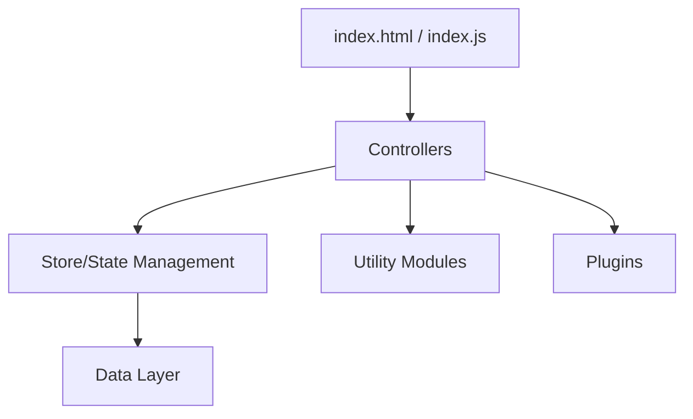

# dream-num/Luckysheet

> Excel-like web spreadsheet in JavaScript, to embed in a page. It is archived.

## The problem
Embedding a full spreadsheet (formulas, pivot tables, charts) in a web application takes a lot of work.

## What it actually does
It handles conditional formatting, formulas, sorting and filtering, pivot tables, charts and comments.
It provides for collaborative editing and Excel import/export via Luckyexcel.
You embed it via CDN with `luckysheet.create({container})`, jQuery required.

## How it is wired


## Trying it
```bash
npm install
npm install gulp -g
npm run dev
npm run build
```

## Cost and gotchas
It is free, but the repository is archived: no fixes, not even security ones. For import, export and printing, the README points to Univer.

## What it is not
It is not a maintained project. It is not a data analysis tool.

## Alternatives
- Univer (same publisher): the successor designated by the README.

## For you
Ignore: the repository is archived and it is a front-end component outside your scope. If you ever need a web spreadsheet, look at Univer.
