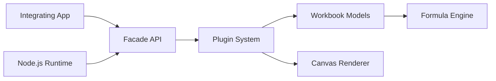

# dream-num/univer

> Open source Office SDK (spreadsheet, documents, presentations) embeddable in the browser or Node.js.

## The problem
Embedding a spreadsheet or document editor in your product forces you to depend on a hosted app.

## What it actually does
Plugin architecture, Canvas rendering, a formula engine and a single Facade API, in the browser or headless Node.js. Preset mode (quick) and Plugin mode (fine-grained control). Also targets AI agents that read and modify Office files. Advanced features (collaboration, import/export, charts, pivot tables) are in the commercial Pro offering.

## How it is wired


## Trying it
```bash
pnpm add @univerjs/presets @univerjs/preset-sheets-core
```
Then `createUniver({ presets: [UniverSheetsCorePreset({ container: 'app' })] })` and `univerAPI.createWorkbook({})`.

## Cost and gotchas
Core is free under Apache-2.0; import/export, collaboration and the server require Univer Pro, which is paid. Keep all `@univerjs/*` packages on the same version.

## What it is not
Not a simple file reader, nor a ready-to-use app: it is an SDK. Does not provide import/export for free.

## Alternatives
None named in the README.

## For you
Watch: interesting for a BI front end or an agent that manipulates spreadsheets on the Node side, but the key features are paid.
