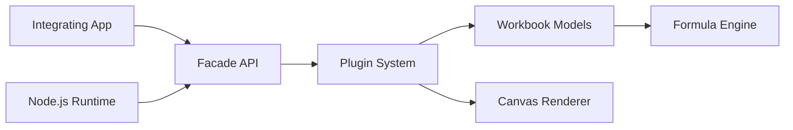

# dream-num/univer

> SDK Office open source (tableur, documents, présentations) embarquable dans le navigateur ou Node.js.

## Le problème
Intégrer un tableur ou un éditeur de documents dans son produit oblige à dépendre d'une appli hébergée.

## Ce que ça fait vraiment
Architecture à plugins, rendu sur Canvas, moteur de formules et une API Facade unique, navigateur ou Node.js headless. Modes Preset (rapide) et Plugin (contrôle fin). Cible aussi les agents IA qui lisent et modifient des fichiers Office. Les fonctions avancées (collaboration, import/export, graphiques, tableaux croisés) sont dans l'offre commerciale Pro.

## Comment c'est branché


## Essayer
```bash
pnpm add @univerjs/presets @univerjs/preset-sheets-core
```
Puis `createUniver({ presets: [UniverSheetsCorePreset({ container: 'app' })] })` et `univerAPI.createWorkbook({})`.

## Coût et pièges
Cœur Apache-2.0 gratuit ; l'import/export, la collaboration et le serveur exigent Univer Pro, payant. Garder tous les paquets `@univerjs/*` sur la même version.

## Ce que ce n'est pas
Pas un simple lecteur de fichiers, ni une appli prête à l'emploi : un SDK. Ne fournit pas gratuitement l'import/export.

## Alternatives
Aucune nommée dans le README.

## Pour toi
Surveiller : intéressant pour un front BI ou agent qui manipule des tableurs côté Node, mais les fonctions clés sont payantes.

