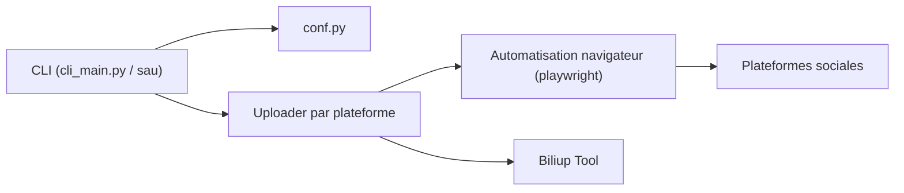

# dreammis/social-auto-upload

> Command-line tool that publishes videos in bulk to Chinese and international social platforms.

## The problem
Publishing the same video to several networks (Douyin, Bilibili, Xiaohongshu, YouTube…) by hand is repetitive and time-consuming.

## What it actually does
A `sau` CLI drives an automated browser to log in (cookies per account), upload a video or a note (title, description, tags) and schedule publication. One module per platform (`uploader/`); Bilibili goes through `biliup`, downloaded automatically. The project is undergoing a major overhaul (switch to `patchright`, headless mode, skills for agents); the old web version is no longer guaranteed.

## How it is wired


## Trying it
```bash
sau douyin login --account <account_name>
sau douyin check --account <account_name>
sau douyin upload-video --account <account_name> --file videos/demo.mp4 --title "Titre" --desc "Description"
sau youtube upload-video --account <account_name> --file videos/demo.mp4 --title "Titre" --desc "Description" --tags tag1,tag2 --visibility public
```

## Cost and gotchas
An account is needed per platform; login is by QR code or Google. The README says it tries to reduce the risk of detection by the platforms: the automation may violate their terms and expose the accounts. Official documentation is "behind" according to the author. The README contains sponsor banners.

## What it is not
It is not an official API: everything relies on driving web interfaces that may change. Not an editorial planning tool.

## Alternatives
The README cites `biliup` (used internally for Bilibili); no other alternative named.

## For you
Ignore: fragile automation of Chinese platforms, maintained by a single person mid-overhaul, unrelated to your data/AI/MLOps work.
