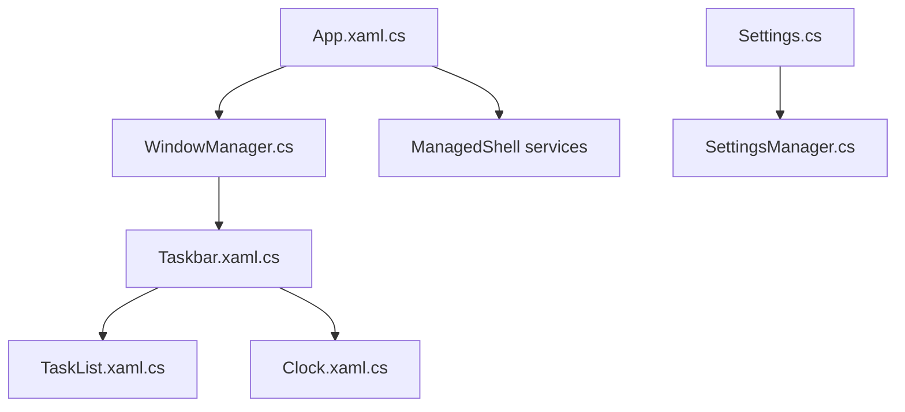

# dremin/RetroBar

> Replaces the Windows taskbar with a classic 95, XP or Vista style, for the nostalgic.

## The problem
The modern Windows taskbar cannot be tuned and no longer looks like older versions.

## What it actually does
WPF application that replaces the native bar: task list with drag and drop, notification area, quick launch, clock, language selector, multi-monitor, Vista-style thumbnails. Several themes included; custom themes and languages as XAML files. It relies on the ManagedShell library.

## How it is wired
Diagram based on the one provided.

## Trying it
The README gives no command: installer or portable version, with the .NET Desktop Runtime downloaded as needed.

## Cost and gotchas
Free. Windows 7 SP1 to 11 required. The .NET runtime is installed automatically by the installer. 498 open issues.

## What it is not
Not a new Start menu: it opens the Windows one. Recommended settings if you use Open-Shell.

## Alternatives
No alternative named in the README.

## For you
Ignore: Windows cosmetics unrelated to your work.
