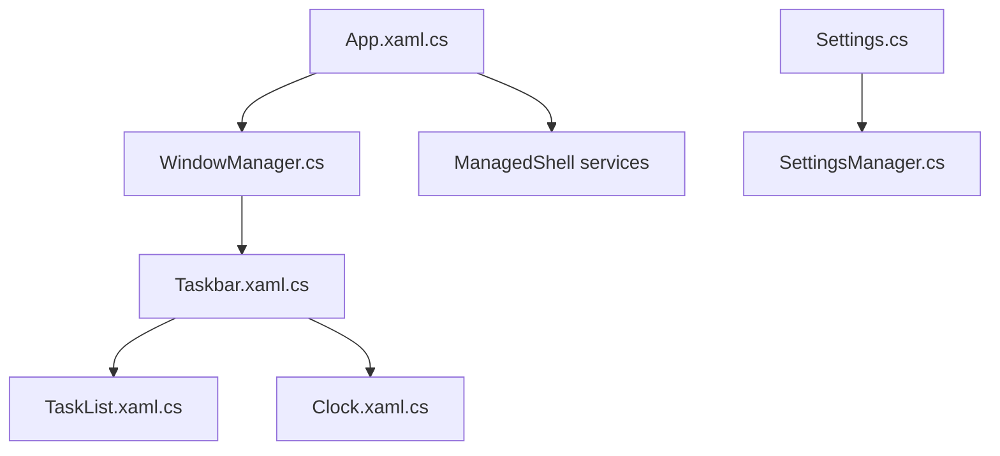

# dremin/RetroBar

> Remplace la barre des tâches Windows par un style classique 95, XP ou Vista, pour nostalgiques.

## Le problème
La barre des tâches moderne de Windows ne se règle pas et ne ressemble plus aux anciennes versions.

## Ce que ça fait vraiment
Application WPF qui remplace la barre native : liste des tâches avec glisser-déposer, zone de notification, lancement rapide, horloge, sélecteur de langue, multi-écrans, miniatures de style Vista. Plusieurs thèmes inclus ; thèmes et langues personnalisés en fichiers XAML. Elle s'appuie sur la bibliothèque ManagedShell.

## Comment c'est branché
Schéma d'après le diagramme fourni.

## Essayer
Le README ne donne pas de commande : installateur ou version portable, avec .NET Desktop Runtime téléchargé au besoin.

## Coût et pièges
Gratuit. Windows 7 SP1 à 11 requis. Le runtime .NET est installé automatiquement par l'installateur. 498 issues ouvertes.

## Ce que ce n'est pas
Pas un nouveau menu Démarrer : il ouvre celui de Windows. Réglages conseillés si tu utilises Open-Shell.

## Alternatives
Aucune alternative nommée dans le README.

## Pour toi
À ignorer : cosmétique Windows sans lien avec ton travail.

