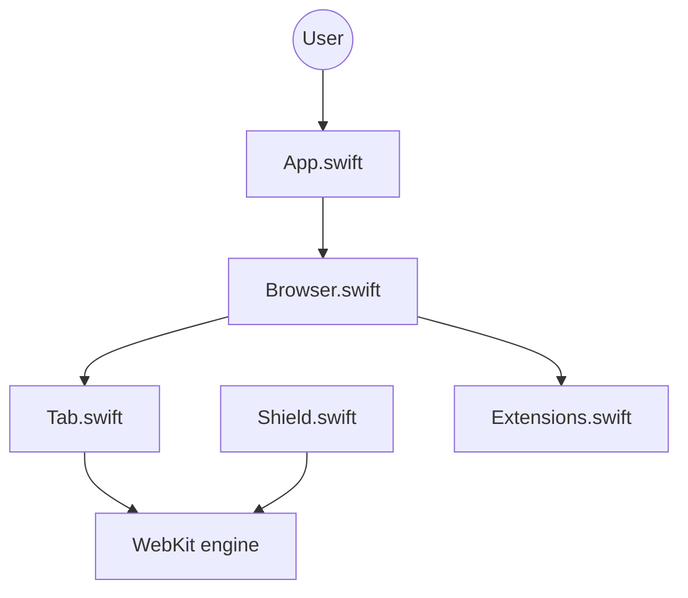

# driceroland/Search

> A minimal macOS browser on WebKit, with no account and no telemetry, by the studio Office Commun.

## The problem
Mainstream browsers have become products loaded with toolbars, accounts and tracking.

## What it actually does
A WebKit browser of about 10 MB with side or top tabs, a single field, an ad blocker compiled into WebKit rules, a reading mode, floating video and a "hide forever" function. It handles passwords in the macOS keychain, Chrome extensions via WebKit and shared view. History and bookmarks stay in local JSON.

## How it is wired


## Trying it
```bash
brew install --cask driceroland/tap/search
swift build
./build.sh
```

## Cost and gotchas
Free, MIT, but limited to macOS 14 or later (15.4 for extensions). A personal build is not notarized: on first launch, right-click, Open. News e-mails, iCloud sync and Handoff can be enabled and send data.

## What it is not
Not a cross-platform browser. The README says "no telemetry", but a daily update request leaves the Mac.

## Alternatives
No alternative named in the README.

## For you
Ignore: a Mac browser, with only a test MCP server (`bench-mcp`) that might interest someone who drives a browser through an agent.
