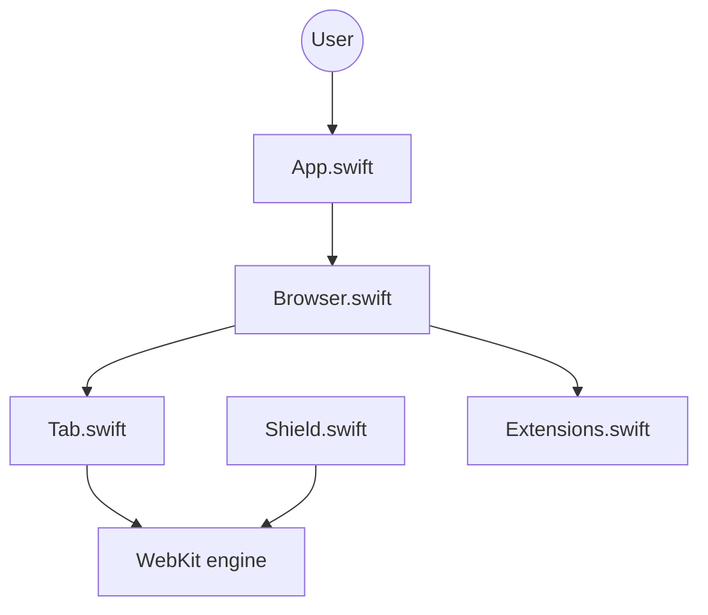

# driceroland/Search

> Navigateur macOS minimal sur WebKit, sans compte ni télémétrie, par le studio Office Commun.

## Le problème
Les navigateurs courants sont devenus des produits chargés de barres, de comptes et de suivi.

## Ce que ça fait vraiment
Un navigateur WebKit d'environ 10 Mo avec onglets latéraux ou en haut, un champ unique, un bloqueur de publicité compilé en règles WebKit, un mode lecture, une vidéo flottante et une fonction « masquer pour toujours ». Il gère mots de passe dans le trousseau macOS, extensions Chrome via WebKit et vue partagée. Historique et favoris restent en JSON local.

## Comment c'est branché


## Essayer
```bash
brew install --cask driceroland/tap/search
swift build
./build.sh
```

## Coût et pièges
Gratuit, MIT, mais réservé à macOS 14 ou plus (15.4 pour les extensions). Une compilation personnelle n'est pas notariée : premier lancement par clic droit, Ouvrir. Les e-mails d'actualité, la synchro iCloud et Handoff sont activables et envoient des données.

## Ce que ce n'est pas
Pas un navigateur multiplateforme. Le README dit « aucune télémétrie », mais une requête quotidienne de mise à jour part du Mac.

## Alternatives
Aucune alternative nommée dans le README.

## Pour toi
À ignorer : un navigateur Mac, avec seulement un serveur MCP de test (`bench-mcp`) qui intéresserait quelqu'un qui pilote un navigateur par agent.

