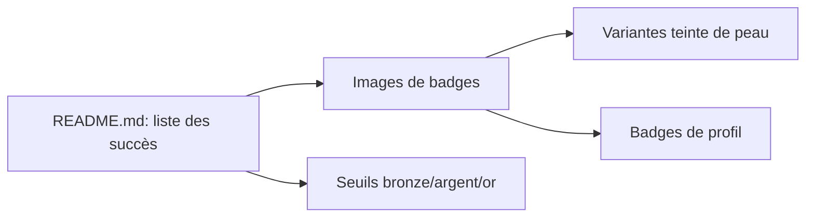

# drknzz/GitHub-Achievements

> Image catalog of GitHub achievement badges, with their unlock conditions.

## The problem
Knowing what the GitHub profile badges correspond to and how to earn them.

## What it actually does
A repository of badge images sorted by achievement and format. The README lists achievements (Starstruck, Quickdraw, Pair Extraordinaire, Pull Shark, Galaxy Brain, YOLO, Public Sponsor) with bronze/silver/gold thresholds (16, 128, 512, 4096 stars for Starstruck), skin tone variants and profile badges, some of which can no longer be obtained (Mars 2020, Arctic Code Vault). Two achievements remain "???". It is not a program that awards achievements.

## How it is wired

## Trying it
No documented command: a repository of images and text.

## Cost and gotchas
Free. The README is partially truncated (broken HTML comment tags, tables without images): incomplete information. Last push in August 2024.

## What it is not
Not an official GitHub tool, and not an up-to-date source of truth on thresholds.

## Alternatives
None cited in the README.

## For you
Ignore: a simple badge gallery that is out of date, with no use for data/AI/MLOps work.
