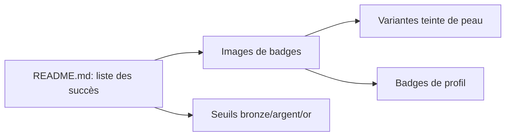

# drknzz/GitHub-Achievements

> Catalogue d'images des badges de succès de GitHub, avec leurs conditions d'obtention.

## Le problème
Savoir à quoi correspondent les badges de profil GitHub et comment les obtenir.

## Ce que ça fait vraiment
Dépôt d'images de badges classées par succès et format. Le README liste des succès (Starstruck, Quickdraw, Pair Extraordinaire, Pull Shark, Galaxy Brain, YOLO, Public Sponsor) avec seuils bronze/argent/or (16, 128, 512, 4096 étoiles pour Starstruck), des variantes de teinte de peau et les badges de profil, dont certains non obtenables (Mars 2020, Arctic Code Vault). Deux succès restent « ??? ». Ce n'est pas un programme qui attribue les succès.

## Comment c'est branché

## Essayer
Aucune commande documentée : dépôt d'images et de texte.

## Coût et pièges
Gratuit. Le README est partiellement tronqué (balises de commentaire HTML cassées, tableaux sans images) : information incomplète. Dernier push en août 2024.

## Ce que ce n'est pas
Pas un outil officiel de GitHub, et pas de source de vérité à jour sur les seuils.

## Alternatives
Aucune citée dans le README.

## Pour toi
Ignorer : simple galerie de badges peu à jour, sans utilité pour un travail data/IA/MLOps.

