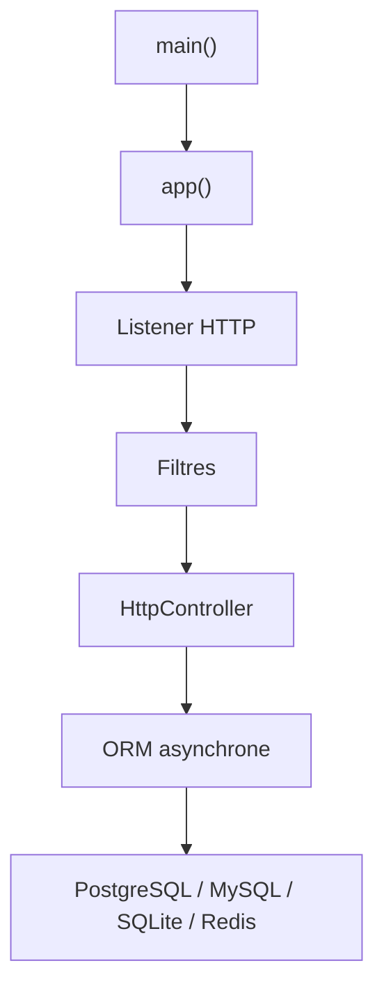

# drogonframework/drogon

> Asynchronous HTTP framework in C++17/20, for building highly concurrent web servers.

## The problem
Writing a web server in C++ with non-blocking I/O, routing and database access takes a lot of low-level code.

## What it actually does
Provides non-blocking network I/O (epoll, kqueue), HTTP 1.0/1.1 server and client, WebSocket, HTTPS, routing by controllers or macros, filters, sessions, compiled CSP views, a lightweight ORM, asynchronous access to PostgreSQL, MySQL, SQLite and Redis, plugins, AOP and coroutines. The `drogon_ctl` tool generates controller code.

## How it is wired


## Trying it
```bash
drogon_ctl create controller TestCtrl
```
```cpp
app().loadConfigFile("./config.json").run();
```

## Cost and gotchas
Free. You need a C++17 compiler and CMake; the build has options (`BUILD_CTL`, `BUILD_ORM`, etc.). No full build command is given beyond the toolchain file for cross-compilation.

## What it is not
Not a Python or Node framework: everything is compiled C++. According to the README, the direct-registration interfaces in `main()` are not suited to complex logic.

## Alternatives
- eclipse-vertx/vert.x: same asynchronous approach, but in Java.

## For you
Ignore: an inference service or a data API is written faster in Python; C++ is only justified by an extreme performance constraint.
