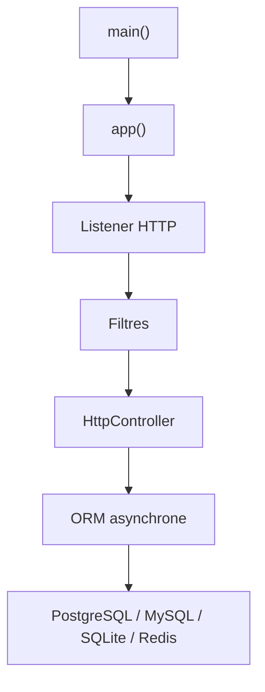

# drogonframework/drogon

> Framework HTTP asynchrone en C++17/20, pour construire des serveurs web très concurrents.

## Le problème
Écrire un serveur web en C++ avec des E/S non bloquantes, du routage et un accès base de données demande beaucoup de code de bas niveau.

## Ce que ça fait vraiment
Fournit des E/S réseau non bloquantes (epoll, kqueue), HTTP 1.0/1.1 serveur et client, WebSocket, HTTPS, routage par contrôleurs ou macros, filtres, sessions, vues CSP compilées, ORM léger, accès asynchrone à PostgreSQL, MySQL, SQLite et Redis, plugins, AOP et coroutines. L'outil `drogon_ctl` génère le code des contrôleurs.

## Comment c'est branché


## Essayer
```bash
drogon_ctl create controller TestCtrl
```
```cpp
app().loadConfigFile("./config.json").run();
```

## Coût et pièges
Gratuit. Il faut un compilateur C++17 et CMake ; la construction a des options (`BUILD_CTL`, `BUILD_ORM`, etc.). Aucune commande de construction complète n'est donnée au-delà du fichier de chaîne d'outils pour la compilation croisée.

## Ce que ce n'est pas
Pas un framework Python ou Node : tout est en C++ compilé. Les interfaces d'enregistrement direct dans `main()` ne conviennent pas, d'après le README, aux logiques complexes.

## Alternatives
- eclipse-vertx/vert.x : même approche asynchrone, mais en Java.

## Pour toi
À ignorer : un service d'inférence ou une API data s'écrit plus vite en Python ; le C++ ne se justifie que pour une contrainte de performance extrême.

