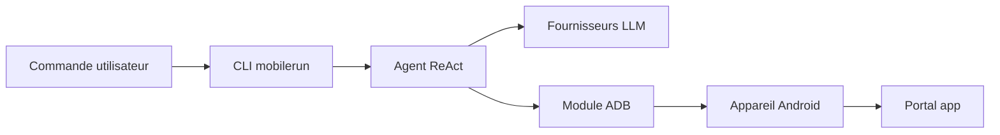

# droidrun/droidrun

> Mobilerun, formerly DroidRun: a framework for driving Android and iOS with LLM agents.

## The problem
Automating mobile applications that have no API forces you into fragile scripts or manual testing.

## What it actually does
Natural-language commands drive a device: reading the accessibility tree and screenshots, tapping, swiping, typing, launching apps. Vision and reasoning modes (manager-executor), structured outputs, custom tools, Arize Phoenix or Langfuse tracing. CLI, TUI, Docker and Python API. OpenAI, Anthropic, Gemini, xAI, Ollama, DeepSeek and OpenRouter models.

## How it is wired


## Trying it
```bash
uv tool install mobilerun
mobilerun setup
mobilerun configure
mobilerun run "Open settings and turn on dark mode"
```

## Cost and gotchas
Python `>=3.11,<3.14`, ADB and a device with USB debugging. The LLM provider key is at your expense. A paid Mobilerun Cloud offering exists alongside (hosted phones).

## What it is not
The architecture diagram supplied describes the old DroidRun project; the README talks about Mobilerun. Benchmarks are cited here without detail. iOS goes through a separate Portal flow.

## Alternatives
No alternative is named in the README.

## For you
Worth watching: interesting for agent-based mobile app testing, but depends on a paid LLM and a recent rename.
