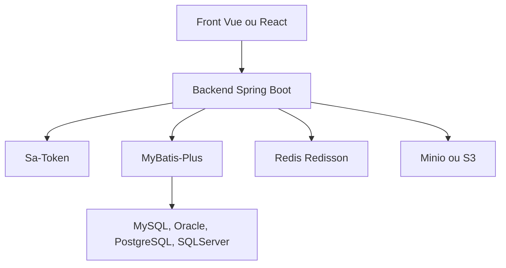

# dromara/RuoYi-Vue-Plus

> Java admin framework for distributed clusters, a rewrite of RuoYi-Vue, with Chinese documentation.

## The problem
An enterprise back office needs authentication, permissions, multi-tenancy, logs and code generation, and the original RuoYi is poorly suited to distributed deployment.

## What it actually does
It is a Spring Boot base rewritten into modules, with Sa-Token for permissions, MyBatis-Plus, Redis via Redisson, SnailJob distributed tasks, WarmFlow workflow and Minio or S3 storage. It also brings data and request encryption, desensitization, multiple data sources, WebSocket and SSE, generated code and Docker deployment. The README is essentially a comparison table with RuoYi.

## How it is wired
Simplified diagram based on the sheet, no diagram provided.



## Trying it
```bash
# Aucune commande dans ce README : voir la documentation (plus-doc.dromara.org), pages « initialiser » et « déployer ».
```

## Cost and gotchas
Free, but Java, Redis, a relational database and a separate front end are required. The official documentation is mostly in Chinese.

## What it is not
It is not compatible with RuoYi-Vue: the README says so. It is not a data or AI tool, only a base for business applications.

## Alternatives
RuoYi-Vue (the original) and RuoYi-Vue-Plus-Single, a variant without multi-tenancy or workflow, both cited in the README.

## For you
Ignore: a general-purpose Java web base, unrelated to data, AI or MLOps.
