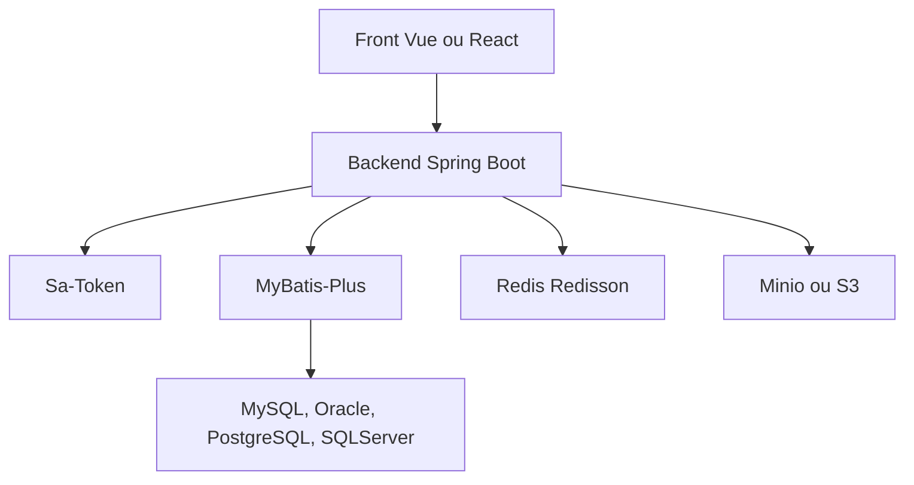

# dromara/RuoYi-Vue-Plus

> Framework d'administration Java pour clusters distribués, réécriture de RuoYi-Vue, à documentation chinoise.

## Le problème
Un back-office d'entreprise demande authentification, droits, multi-tenant, journaux et génération de code, et le RuoYi d'origine se prête mal à un déploiement distribué.

## Ce que ça fait vraiment
C'est un socle Spring Boot réécrit en modules, avec Sa-Token pour les droits, MyBatis-Plus, Redis via Redisson, tâches distribuées SnailJob, workflow WarmFlow et stockage Minio ou S3. Il apporte aussi chiffrement des données et des requêtes, désensibilisation, multi-sources de données, WebSocket et SSE, code généré et déploiement Docker. Le README est essentiellement un tableau comparatif avec RuoYi.

## Comment c'est branché
Schéma simplifié d'après la fiche, sans diagramme fourni.



## Essayer
```bash
# Aucune commande dans ce README : voir la documentation (plus-doc.dromara.org), pages « initialiser » et « déployer ».
```

## Coût et pièges
Gratuit, mais Java, Redis, une base relationnelle et un front séparé sont nécessaires. La documentation officielle est surtout en chinois.

## Ce que ce n'est pas
Ce n'est pas compatible avec RuoYi-Vue : le README le précise. Ce n'est pas un outil data ou IA, seulement un socle d'applications de gestion.

## Alternatives
RuoYi-Vue (l'original) et RuoYi-Vue-Plus-Single, variante sans multi-tenant ni workflow, tous deux cités dans le README.

## Pour toi
À ignorer : socle web Java généraliste, sans lien avec la data, l'IA ou le MLOps.

