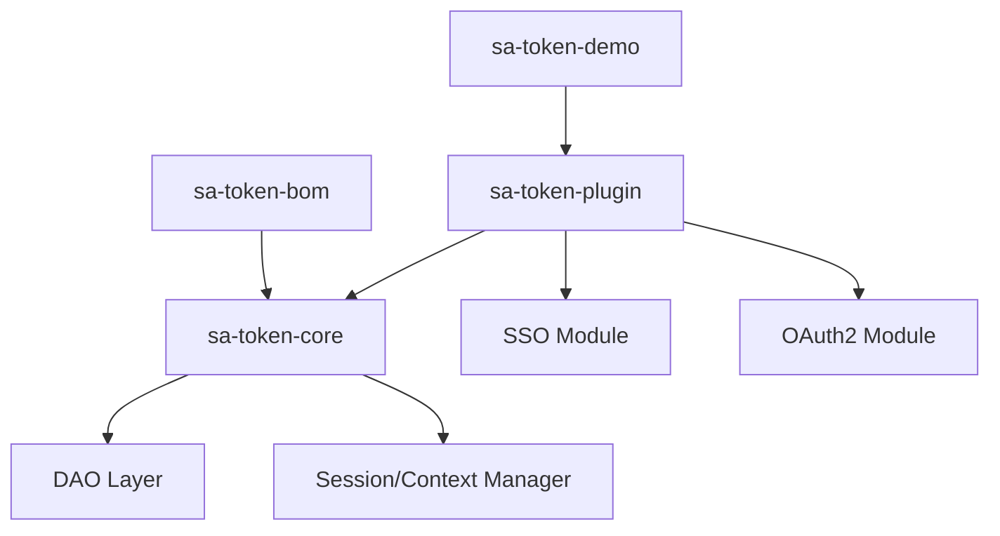

# dromara/Sa-Token

> Java authentication and authorization framework (login, permissions, SSO, OAuth2) for Spring Boot application developers.

## The problem
Hand-writing session management, roles, SSO and OAuth2 in a Java application is slow and error-prone.

## What it actually does
Provides static calls (`StpUtil.login`, `checkLogin`, `kickout`) and annotations (`@SaCheckPermission`) to authenticate and authorize. Five modules: login, permissions, SSO, OAuth2, microservices. Sessions can be stored in Redis. Spring Boot, Solon, JFinal integrations. Documentation mostly in Chinese.

## How it is wired
Diagram based on the code diagram: the core carries the plugins and the demos.



## Trying it
```bash
git checkout master
```
Maven dependency: `cn.dev33:sa-token-spring-boot-starter:1.46.0` in pom.xml.

## Cost and gotchas
Free (Apache-2.0). Requires Java and Maven, absent from the prerequisites list. Redis only for persistence. Docs and community in Chinese.

## What it is not
Not a product for Python or data. Not a hosted identity provider. Not a wrapper around Spring Security or Shiro according to the README.

## Alternatives
- Spring Security: the standard of the Spring ecosystem, cited in comparison.
- Apache Shiro: competitor cited in the README.

## For you
Ignore: it is a Java authentication building block, unrelated to a data / AI / MLOps profile, unless you maintain a Spring back-end.
