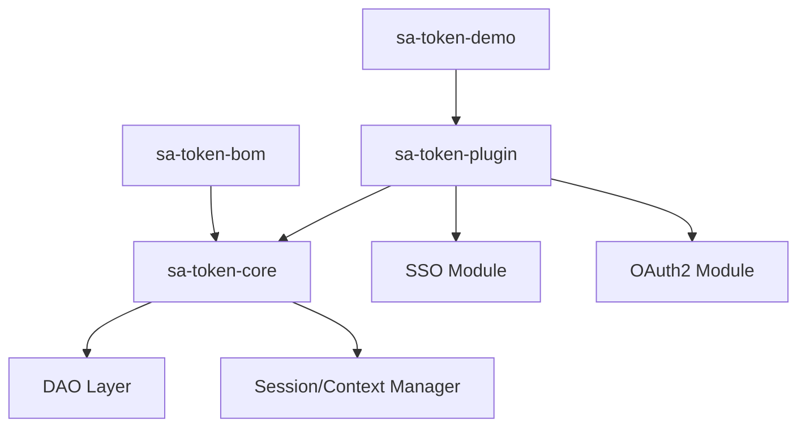

# dromara/Sa-Token

> Framework Java d'authentification et d'autorisation (login, permissions, SSO, OAuth2) pour développeurs d'applications Spring Boot.

## Le problème
Écrire à la main la gestion des sessions, des rôles, du SSO et d'OAuth2 dans une application Java est long et source d'erreurs.

## Ce que ça fait vraiment
Fournit des appels statiques (`StpUtil.login`, `checkLogin`, `kickout`) et des annotations (`@SaCheckPermission`) pour authentifier et autoriser. Cinq modules : login, permissions, SSO, OAuth2, microservices. Sessions stockables dans Redis. Intégrations Spring Boot, Solon, JFinal. Documentation surtout en chinois.

## Comment c'est branché
Schéma d'après le diagramme du code : le cœur porte les plugins et les démos.



## Essayer
```bash
git checkout master
```
Dépendance Maven : `cn.dev33:sa-token-spring-boot-starter:1.46.0` dans le pom.xml.

## Coût et pièges
Gratuit (Apache-2.0). Nécessite Java et Maven, absents de la liste des prérequis. Redis seulement pour la persistance. Doc et communauté en chinois.

## Ce que ce n'est pas
Pas un produit pour Python ou la data. Ce n'est pas un fournisseur d'identité hébergé. Ce n'est pas un encapsulage de Spring Security ou Shiro d'après le README.

## Alternatives
- Spring Security : standard de l'écosystème Spring, cité en comparaison.
- Apache Shiro : concurrent cité dans le README.

## Pour toi
À ignorer : c'est une brique Java d'authentification, sans rapport avec un profil data / IA / MLOps, sauf si tu maintiens un back-end Spring.

