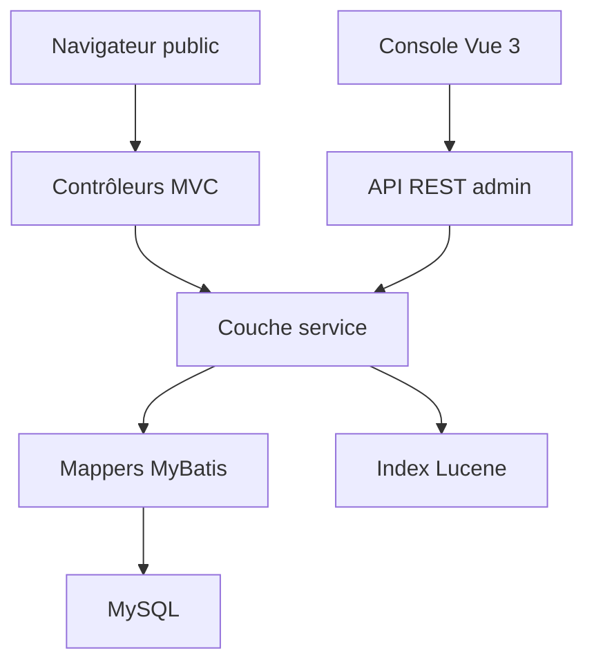

# dromara/ujcms

> Enterprise CMS in Java, with Freemarker template modes and headless API, documented in Chinese.

## The problem
Build and administer a content site with a back office, without starting from scratch.

## What it actually does
Monolithic Spring Boot application with MyBatis, Liquibase, Lucene search and a Vue 3 admin console. It serves pages through templates or a REST API for a separate front end. A token-protected installation wizard is enabled on first startup.

## How it is wired


## Trying it
```bash
cd ujcms-starter/src/main/webapp/themes/1/default && npm install && npm run build
pnpm --dir ujcms-ui-console install
pnpm --dir ujcms-ui-console build:starter
./mvnw clean spring-boot:run
```

## Cost and gotchas
Free under GPL-3.0; a commercial license exists for closed-source code. Requires JDK 17 or 21, MySQL 8, Node 22.12+ and pnpm. Java is not in the prerequisites list. Unattended installation exposes a sample password.

## What it is not
Not a turnkey solution without a database; the documentation is in Chinese.

## Alternatives
No alternative named in the README.

## For you
Ignore: Java CMS with no link to data, AI or MLOps.
