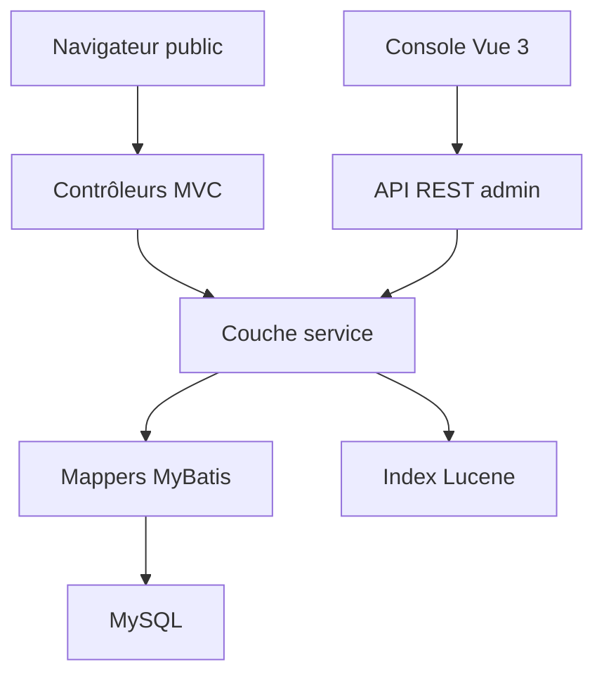

# dromara/ujcms

> CMS d'entreprise en Java, avec modes gabarits Freemarker et API sans tête, documenté en chinois.

## Le problème
Construire et administrer un site de contenu avec back-office, sans repartir de zéro.

## Ce que ça fait vraiment
Application Spring Boot monolithique avec MyBatis, Liquibase, recherche Lucene et console d'administration Vue 3. Elle sert des pages par gabarits ou une API REST pour un front séparé. Un assistant d'installation protégé par jeton s'active au premier démarrage.

## Comment c'est branché


## Essayer
```bash
cd ujcms-starter/src/main/webapp/themes/1/default && npm install && npm run build
pnpm --dir ujcms-ui-console install
pnpm --dir ujcms-ui-console build:starter
./mvnw clean spring-boot:run
```

## Coût et pièges
Gratuit en GPL-3.0 ; une licence commerciale existe pour le code fermé. Il faut JDK 17 ou 21, MySQL 8, Node 22.12+ et pnpm. Java n'existe pas dans la liste des prérequis. L'installation sans surveillance expose un mot de passe d'exemple.

## Ce que ce n'est pas
Pas une solution clé en main sans base de données ; la documentation est en chinois.

## Alternatives
Aucune alternative nommée dans le README.

## Pour toi
À ignorer : CMS Java sans lien avec la donnée, l'IA ou le MLOps.

