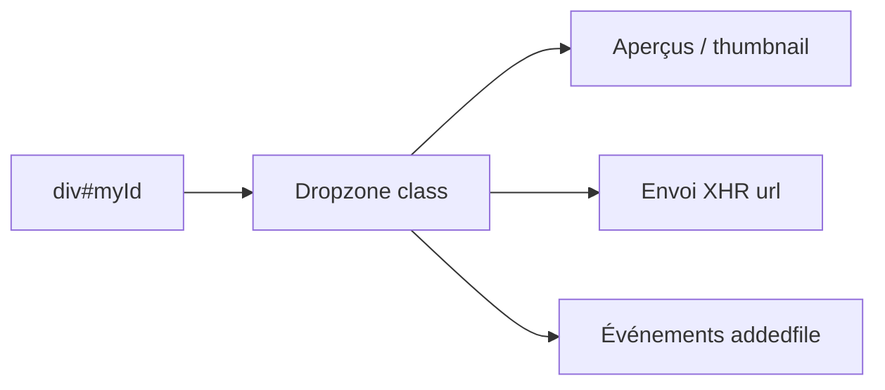

# dropzone/dropzone

> JavaScript library that turns an HTML element into a drag-and-drop zone with previews and XHR upload.

## The problem
Handling drag-and-drop file uploads (previews, progress, large files) takes a lot of browser-side code.

## What it actually does
Written in TypeScript, it ships its own types. Image previews, high screen density, multiple uploads, progress, chunked uploads, S3 multipart, resizing before upload, fully replaceable theme. Version 6: IE not supported. Monorepo: library, Docusaurus docs, SvelteKit site.

## How it is wired


## Trying it
```bash
npm install dropzone
pnpm install
pnpm build
pnpm test
```
```js
import { Dropzone } from "dropzone";
const dropzone = new Dropzone("div#myId", { url: "/file/post" });
```

## Cost and gotchas
Free. License present but not identified by GitHub: to be checked. Uninstall `@types/dropzone` (obsolete, v5).

## What it is not
Not a receiving server: the upload endpoint is still yours to write.

## Alternatives
No alternative named in the README.

## For you
A front-end building block for an internal annotation or data import tool, nothing more: ignore.
