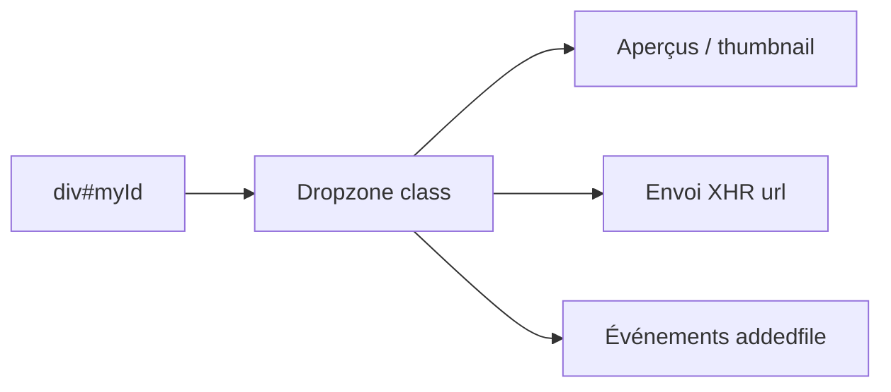

# dropzone/dropzone

> Bibliothèque JavaScript qui transforme un élément HTML en zone de glisser-déposer avec aperçus et envoi XHR.

## Le problème
Gérer l'envoi de fichiers par glisser-déposer (aperçus, progression, gros fichiers) demande beaucoup de code côté navigateur.

## Ce que ça fait vraiment
Écrite en TypeScript, elle livre ses propres types. Aperçus d'images, haute densité d'écran, envois multiples, progression, envois par morceaux, multipart S3, redimensionnement avant envoi, thème entièrement remplaçable. Version 6 : IE non supporté. Monorepo : bibliothèque, doc Docusaurus, site SvelteKit.

## Comment c'est branché


## Essayer
```bash
npm install dropzone
pnpm install
pnpm build
pnpm test
```
```js
import { Dropzone } from "dropzone";
const dropzone = new Dropzone("div#myId", { url: "/file/post" });
```

## Coût et pièges
Gratuit. Licence présente mais non identifiée par GitHub : à vérifier. Désinstaller `@types/dropzone` (obsolète, v5).

## Ce que ce n'est pas
Pas un serveur de réception : l'endpoint d'envoi reste à écrire.

## Alternatives
Aucune alternative nommée dans le README.

## Pour toi
Brique front pour un outil interne d'annotation ou d'import de données, rien de plus : à ignorer.

