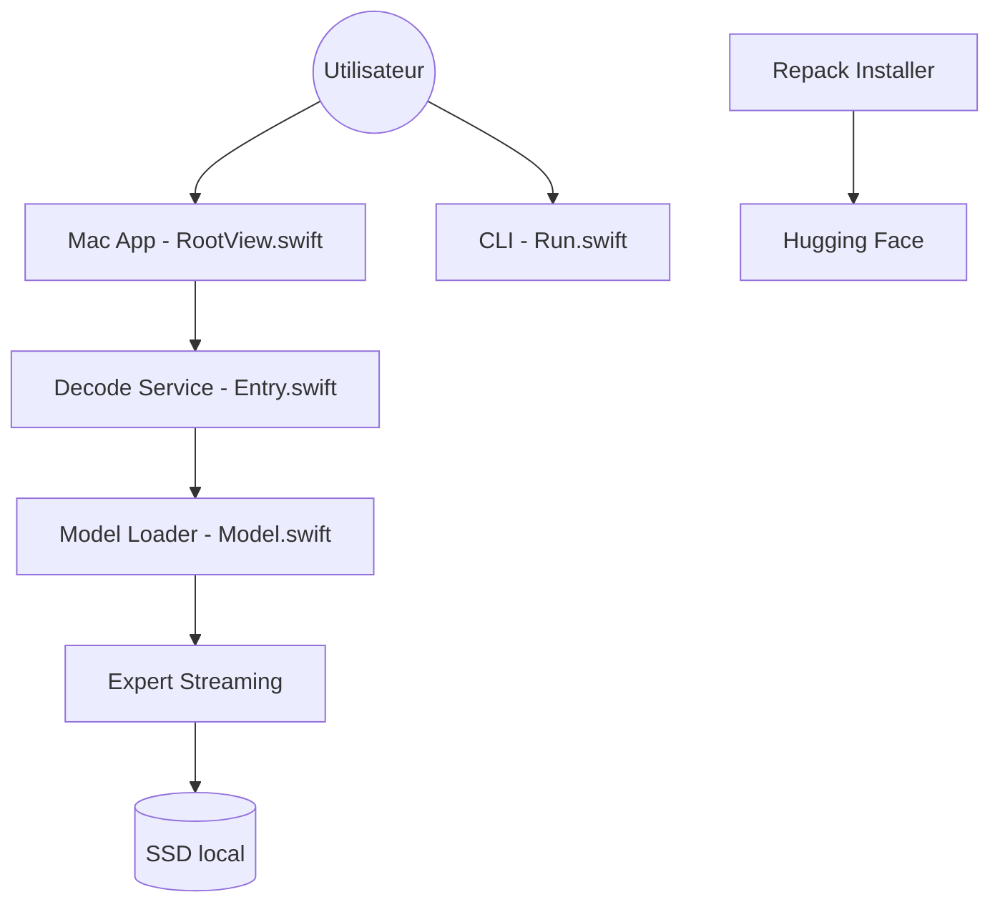

# drumih/turbo-fieldfare

> Swift and Metal runtime that runs Gemma 4 26B-A4B in about 2 GB of RAM on a Mac.

## The problem
A 26-billion-parameter model does not fit in the memory of an 8 GB Mac.

## What it actually does
Keeps a shared 1.35 GB core and the KV cache in memory, and reads from the SSD only the MoE experts needed for each token. The whole thing is a runtime dedicated to the model (not a wrapper around MLX or llama.cpp), with Metal kernels, a streaming installer, a CLI, an OpenAI-compatible local server and a Mac app. Measured throughput: 5.5 to 6.8 tokens/s on an 8 GB M2.

## How it is wired


## Trying it
```bash
git clone https://github.com/drumih/turbo-fieldfare.git
cd turbo-fieldfare
swift build -c release
.build/release/TurboFieldfareMac
```

## Cost and gotchas
Apple Silicon, macOS 26, Metal 4 and Swift 6.2 required. Download of about 15 GB (14.3 GB installed). Only one process can own the model at a time. The server has no authentication or TLS: stay on loopback.

## What it is not
Not a generic engine: a single model (Gemma 4 26B-A4B). No audio or video support. Neither Linux nor Windows.

## Alternatives
- MLX / llama.cpp: for other models or other platforms (the README states that the project does not wrap them).

## For you
Technical curiosity useful for understanding MoE expert streaming; reserved for recent Macs, to watch rather than adopt.
