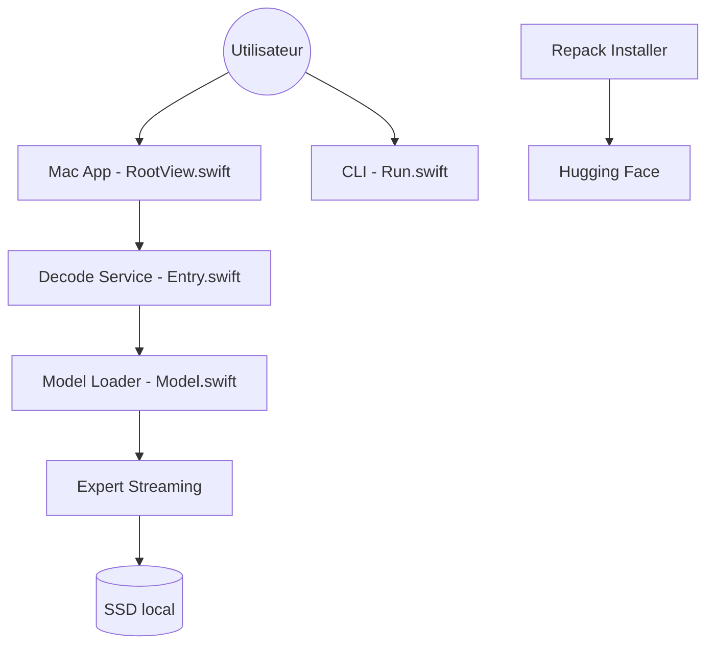

# drumih/turbo-fieldfare

> Runtime Swift et Metal qui fait tourner Gemma 4 26B-A4B dans environ 2 Go de RAM sur Mac.

## Le problème
Un modèle de 26 milliards de paramètres ne tient pas dans la mémoire d'un Mac de 8 Go.

## Ce que ça fait vraiment
Garde en mémoire un noyau partagé de 1,35 Go et le cache KV, et lit depuis le SSD seulement les experts MoE utiles à chaque token. Le tout est un runtime dédié au modèle (pas un wrapper de MLX ou llama.cpp), avec noyaux Metal, installeur en flux, CLI, serveur local compatible OpenAI et application Mac. Débit mesuré : 5,5 à 6,8 tokens/s sur un M2 de 8 Go.

## Comment c'est branché


## Essayer
```bash
git clone https://github.com/drumih/turbo-fieldfare.git
cd turbo-fieldfare
swift build -c release
.build/release/TurboFieldfareMac
```

## Coût et pièges
Apple Silicon, macOS 26, Metal 4 et Swift 6.2 requis. Téléchargement d'environ 15 Go (14,3 Go installés). Un seul processus propriétaire du modèle à la fois. Le serveur n'a ni authentification ni TLS : rester en loopback.

## Ce que ce n'est pas
Pas un moteur générique : un seul modèle (Gemma 4 26B-A4B). Pas de support audio ni vidéo. Ni Linux ni Windows.

## Alternatives
- MLX / llama.cpp : pour d'autres modèles ou d'autres plateformes (le README précise que le projet ne les enrobe pas).

## Pour toi
Curiosité technique utile pour comprendre le streaming d'experts MoE ; réservé aux Mac récents, à surveiller plus qu'à adopter.

