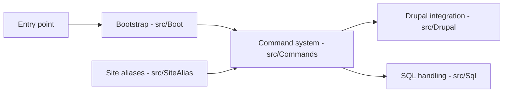

# drush-ops/drush

> Unix command-line and scripting interface for administering Drupal sites.

## The problem
Administering a Drupal site from the browser is slow and hard to automate.

## What it actually does
The README is a single sentence and points to www.drush.org. According to the architecture description (generic, not verified against the code): command systems, Drupal bootstrap, site aliases, configuration and SQL handling, built on Symfony Console. Details are not documented here.

## How it is wired

## Trying it
No commands in the README. Not documented here (see www.drush.org).

## Cost and gotchas
Free. License missing from the catalog: check before redistributing. Many open issues (492).

## What it is not
Not a CMS: it assumes an existing Drupal site. Minimal README, so this sheet is deliberately brief.

## Alternatives
None named in the README.

## For you
Ignore: Drupal tool unrelated to data/AI/MLOps.
