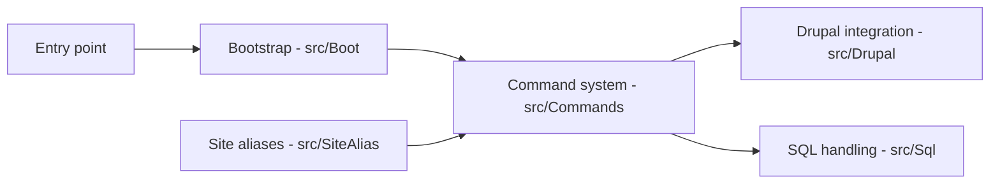

# drush-ops/drush

> Interface en ligne de commande et de scripts Unix pour administrer des sites Drupal.

## Le problème
Administrer un site Drupal depuis le navigateur est lent et peu automatisable.

## Ce que ça fait vraiment
Le README fait une seule phrase et renvoie vers www.drush.org. D'après la description d'architecture (générique, non vérifiée sur le code) : systèmes de commandes, amorçage Drupal, alias de sites, configuration et gestion SQL, sur Symfony Console. Détail non documenté ici.

## Comment c'est branché

## Essayer
Aucune commande dans le README. Non documenté ici (voir www.drush.org).

## Coût et pièges
Gratuit. Licence absente du catalogue : à vérifier avant redistribution. Beaucoup d'issues ouvertes (492).

## Ce que ce n'est pas
Pas un CMS : il suppose un site Drupal existant. README minimal, fiche volontairement sommaire.

## Alternatives
Aucune nommée dans le README.

## Pour toi
Ignorer : outil Drupal sans rapport avec data/IA/MLOps.

