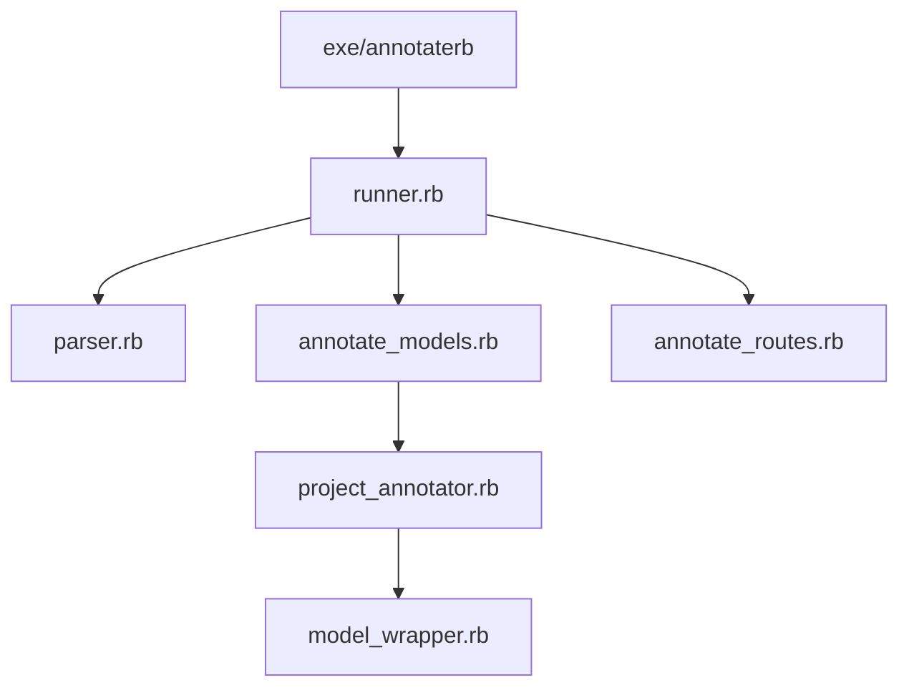

# drwl/annotaterb

> Ruby gem that adds table schemas as comments in Rails models and routes.

## The problem
In a Rails project, a table's columns are not visible in the model that maps to it.

## What it actually does
Generates a schema comment (columns, indexes, foreign keys) in models, fixtures, tests, factories and `routes.rb`. A rake task reruns the annotation after migrations. Configuration lives in `.annotaterb.yml`, with many position and sorting options.

## How it is wired


## Trying it
```bash
gem install annotaterb
bin/rails g annotate_rb:install
bin/rails db:migrate
```

## Cost and gotchas
Free. You need Ruby and a Rails project, Ruby not being in the prerequisites list. License present but not identified by GitHub. Fork of the Annotate gem.

## What it is not
Not a standalone database documentation generator: it annotates Rails files.

## Alternatives
Annotate (AnnotateModels), of which it is a fork.

## For you
Ignore: Rails tool, outside Python and AI.
