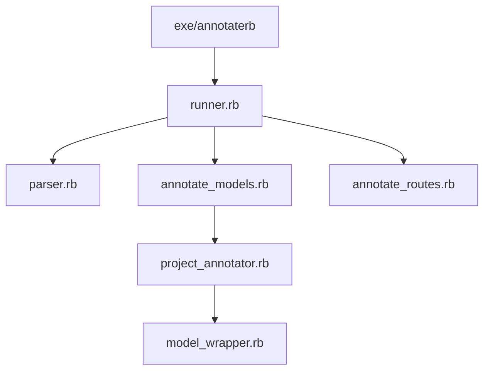

# drwl/annotaterb

> Gemme Ruby qui ajoute en commentaire le schéma des tables dans les modèles et routes Rails.

## Le problème
Dans un projet Rails, les colonnes d'une table ne sont pas visibles dans le modèle qui s'y rapporte.

## Ce que ça fait vraiment
Génère un commentaire de schéma (colonnes, index, clés étrangères) dans les modèles, fixtures, tests, factories et `routes.rb`. Une tâche rake relance l'annotation après les migrations. La configuration vit dans `.annotaterb.yml`, avec de nombreuses options de position et de tri.

## Comment c'est branché


## Essayer
```bash
gem install annotaterb
bin/rails g annotate_rb:install
bin/rails db:migrate
```

## Coût et pièges
Gratuit. Il faut Ruby et un projet Rails, Ruby n'existant pas dans la liste des prérequis. Licence présente mais non identifiée par GitHub. Fork de la gemme Annotate.

## Ce que ce n'est pas
Pas un générateur de documentation de base de données autonome : il annote des fichiers Rails.

## Alternatives
Annotate (AnnotateModels), dont il est un fork.

## Pour toi
À ignorer : outil Rails, hors Python et IA.

