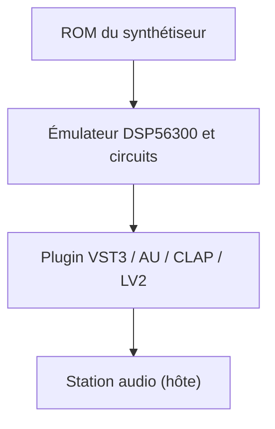

# dsp56300/gearmulator

> Emulation of 1990s and 2000s synthesizers that runs their original firmware as audio plugins.

## The problem
Classic hardware synthesizers (Access Virus, Waldorf microQ, Roland JP-8000) are expensive, bulky and aging.

## What it actually does
Emulates the devices' integrated circuits to run their original ROM as FST, VST3, AU, CLAP and LV2 plugins. Supported devices: Osirus, OsTIrus, Vavra, Xenia, Nodal Red 2x, JE-8086, 88emu. Compatible with x64 and ARM aarch64, Windows, macOS and Linux.

## How it is wired
Simplified diagram based on the sheet, no diagram provided.

## Trying it
No command in the README: it lists the CMake options (for example `gearmulator_BUILD_JUCEPLUGIN`) but gives no complete build line.

## Cost and gotchas
Free, GPL-3.0. C++17 build with CMake. The README mentions the original firmware (ROM) without specifying how to obtain it. 32-bit architectures are not supported.

## What it is not
Not a new synthesizer: an emulation of existing hardware.

## Alternatives
No alternative named in the README.

## For you
Ignore: synthesis audio plugins, unrelated to data, AI or MLOps.
