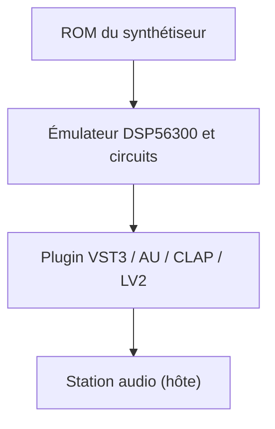

# dsp56300/gearmulator

> Émulation de synthétiseurs des années 1990 et 2000 qui exécute leur firmware d'origine en plugins audio.

## Le problème
Les synthétiseurs matériels classiques (Access Virus, Waldorf microQ, Roland JP-8000) sont chers, encombrants et vieillissants.

## Ce que ça fait vraiment
Émule les circuits intégrés des appareils pour faire tourner leur ROM d'origine sous forme de plugins FST, VST3, AU, CLAP et LV2. Appareils supportés : Osirus, OsTIrus, Vavra, Xenia, Nodal Red 2x, JE-8086, 88emu. Compatible x64 et ARM aarch64, Windows, macOS et Linux.

## Comment c'est branché
Schéma simplifié d'après la fiche, sans diagramme fourni.

## Essayer
Aucune commande dans le README : il liste les options CMake (par exemple `gearmulator_BUILD_JUCEPLUGIN`) mais ne donne pas de ligne de build complète.

## Coût et pièges
Gratuit, GPL-3.0. Compilation C++17 avec CMake. Le README parle du firmware d'origine (ROM) sans préciser comment l'obtenir. Les architectures 32 bits ne sont pas supportées.

## Ce que ce n'est pas
Pas un synthétiseur nouveau : une émulation de matériel existant.

## Alternatives
Aucune alternative nommée dans le README.

## Pour toi
À ignorer : plugins audio de synthèse, sans lien avec la data, l'IA ou le MLOps.

