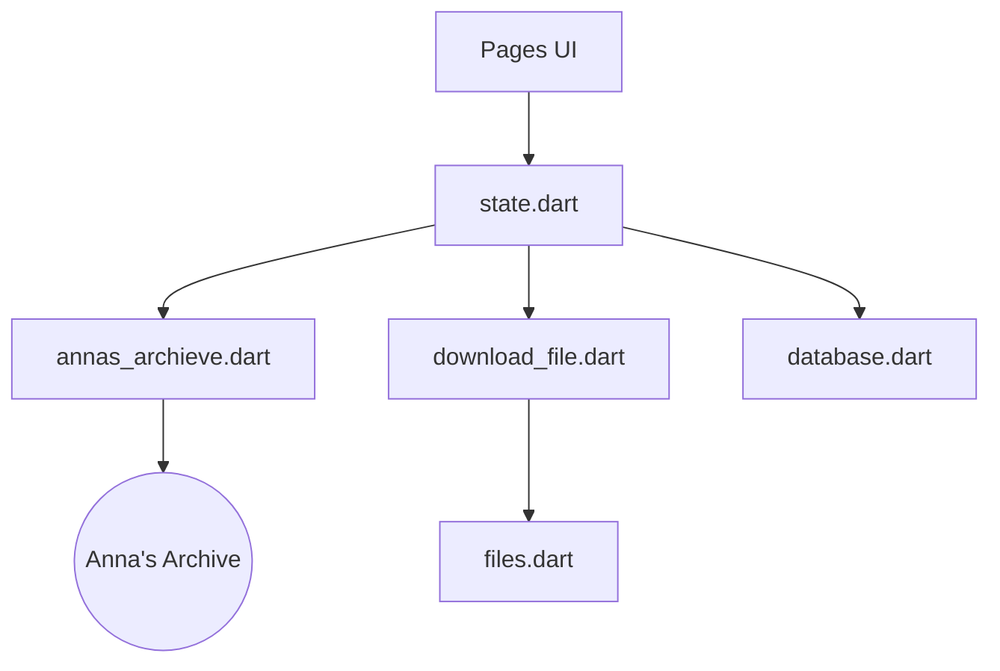

# dstark5/Openlib

> Flutter application that searches, downloads and reads books from Anna's Archive.

## The problem
Anna's Archive has no API: you go through the website to find and fetch a book.

## What it actually does
The app sends requests to the site, parses the HTML pages, extracts the mirrors, then downloads the file. It offers trending books, filters, sorting and a built-in EPUB and PDF reader. Metadata can come from Goodreads and Open Library. Everything stays local.

## How it is wired


## Trying it
```sh
git clone https://github.com/dstark5/Openlib.git
flutter pub get
flutter run
flutter build
```

## Cost and gotchas
Free. The app is in beta. Publishing it on Google Play would violate their terms. It accesses a shadow library: copyright risk, which the README shifts onto the user.

## What it is not
Not a legal library nor a service: a client that depends on the third-party site and its structure.

## Alternatives
No alternative named in the README.

## For you
Ignore: copyright issue, no link with your work, and a fragile project (beta, one maintainer).
