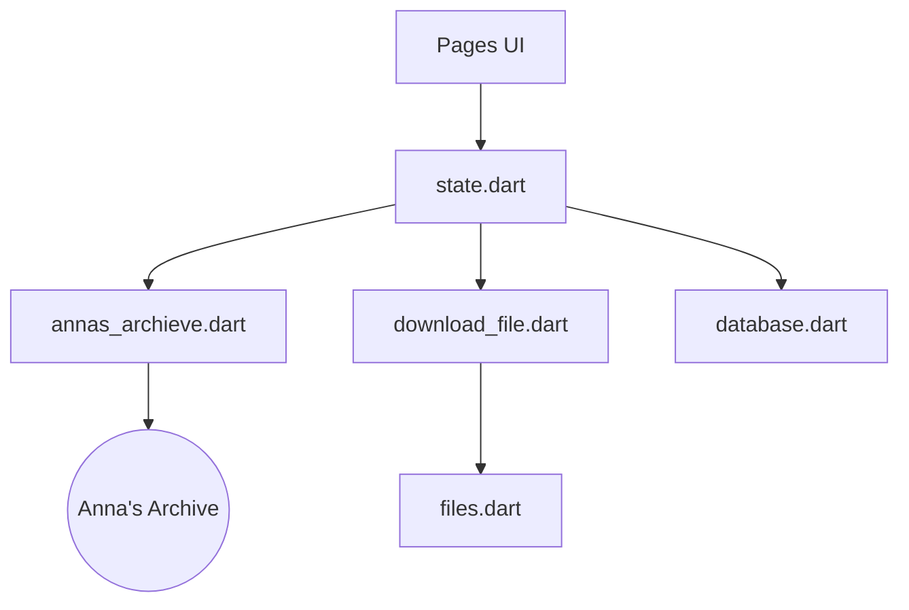

# dstark5/Openlib

> Application Flutter qui cherche, télécharge et lit des livres depuis Anna's Archive.

## Le problème
Anna's Archive n'a pas d'API : on passe par le site web pour trouver et récupérer un livre.

## Ce que ça fait vraiment
L'app envoie des requêtes au site, analyse les pages HTML, extrait les miroirs puis télécharge le fichier. Elle propose livres tendance, filtres, tris et un lecteur intégré EPUB et PDF. Les métadonnées peuvent venir de Goodreads et Open Library. Tout reste local.

## Comment c'est branché


## Essayer
```sh
git clone https://github.com/dstark5/Openlib.git
flutter pub get
flutter run
flutter build
```

## Coût et pièges
Gratuit. L'app est en bêta. La publier sur Google Play violerait leurs conditions. Elle accède à une bibliothèque fantôme : risque de droit d'auteur, que le README rejette sur l'utilisateur.

## Ce que ce n'est pas
Pas une bibliothèque légale ni un service : un client qui dépend du site tiers et de sa structure.

## Alternatives
Aucune alternative nommée dans le README.

## Pour toi
À ignorer : enjeu de droit d'auteur, aucun lien avec ton travail, et projet fragile (bêta, un mainteneur).

