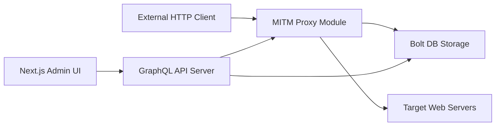

# dstotijn/hetty

> Open source HTTP toolkit for security research, an intercepting proxy with a web interface.

## The problem
Inspecting and replaying HTTP traffic during an authorized audit requires an intercepting proxy. The commercial solutions in this field are paid.

## What it actually does
A single Go process acts as a MITM proxy, exposes a GraphQL API and serves a web interface (Next.js). It logs requests with search, lets you intercept, modify and replay them, and manages a scope. Data is stored per project in an embedded Bolt database.

## How it is wired


## Trying it
```bash
brew install hettysoft/tap/hetty
sudo snap install hetty
hetty
hetty --help
docker run -v $HOME/.hetty:/root/.hetty -p 8080:8080 \
  ghcr.io/dstotijn/hetty:latest
```

## Cost and gotchas
Free, MIT license. The proxy generates a local root certificate authority (`~/.hetty/`) whose key must be kept protected. Use it only on traffic whose content you have the right to process.

## What it is not
It is not a full equivalent of the commercial suites: the README says it aims for that goal, not that it has reached it. It is presented as under active development; building from source is marked "link coming soon".

## Alternatives
- Burp Suite Pro: the commercial reference cited, more complete but paid.

## For you
Worth watching: handy for observing the HTTP calls of a service or a model API locally, but outside the core data/AI work and maintained by a single maintainer.
