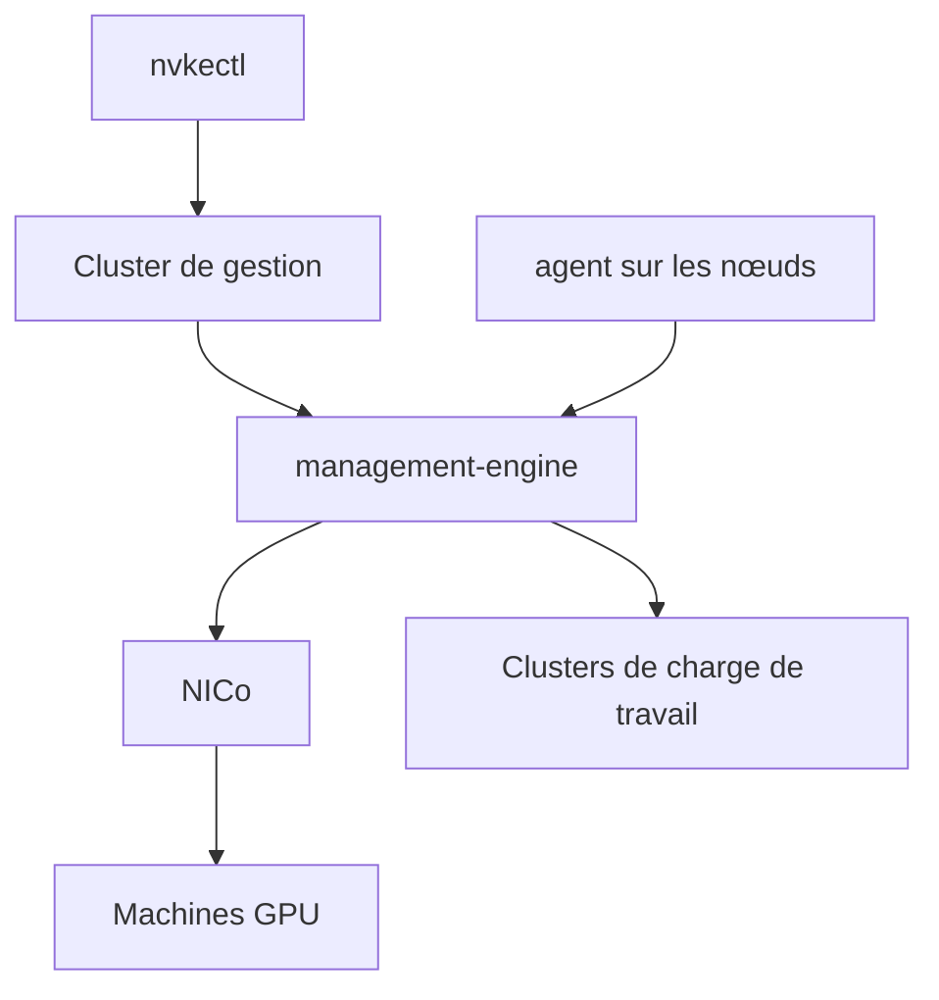

# dsx-ai-factory/nvke

> Management plane that provisions Kubernetes clusters on your NVIDIA GPU infrastructure, for platform teams.

## The problem
Offering isolated Kubernetes clusters to several customers on GPU machines without managed bare metal requires heavy tooling.

## What it actually does
A management cluster creates and operates workload clusters, each with its own control plane, etcd and node groups. Machines come from NVIDIA Infra Controller (NICo). Nodes attest via SPIFFE/SPIRE and TPM. The project is in preview.

## How it is wired


## Trying it
```bash
git clone https://github.com/dsx-ai-factory/nvke.git
cd nvke
make build
```

## Cost and gotchas
Local evaluation requires 6 CPUs, 12 GiB of memory, 100 GiB of disk, Docker and a virtual TPM. A real installation requires GPU machines and NICo. API authentication is disabled and HTTP is in clear text by default.

## What it is not
Not a Kubernetes distribution nor a Cluster API variant. Not production-ready: no upgrade or backup of the management plane. The FDE node images do not protect data at rest.

## Alternatives
None named in the README.

## For you
Concerns teams that manage GPU fleets for training or inference; in preview, follow it without adopting it.
