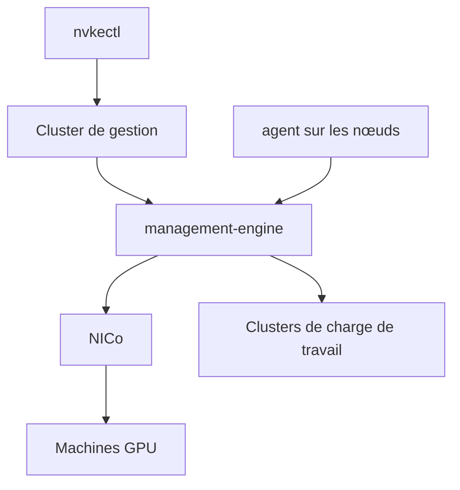

# dsx-ai-factory/nvke

> Plan de gestion qui fournit des clusters Kubernetes sur ton infrastructure GPU NVIDIA, pour équipes plateforme.

## Le problème
Offrir des clusters Kubernetes isolés à plusieurs clients sur des machines GPU sans vrai métal géré demande un outillage lourd.

## Ce que ça fait vraiment
Un cluster de gestion crée et exploite des clusters de charge de travail, chacun avec son plan de contrôle, etcd et ses groupes de nœuds. Les machines viennent de NVIDIA Infra Controller (NICo). Les nœuds s'attestent via SPIFFE/SPIRE et TPM. Le projet est en préversion.

## Comment c'est branché


## Essayer
```bash
git clone https://github.com/dsx-ai-factory/nvke.git
cd nvke
make build
```

## Coût et pièges
L'évaluation locale demande 6 CPU, 12 Gio de mémoire, 100 Gio de disque, Docker et un TPM virtuel. Une vraie installation exige des machines GPU et NICo. L'authentification de l'API est désactivée et le HTTP est en clair par défaut.

## Ce que ce n'est pas
Pas une distribution Kubernetes ni une variante Cluster API. Pas prêt pour la production : pas de mise à jour ni de sauvegarde du plan de gestion. Les images de nœuds FDE ne protègent pas les données au repos.

## Alternatives
Aucune nommée dans le README.

## Pour toi
Concerne les équipes qui gèrent des parcs GPU pour l'entraînement ou l'inférence ; en préversion, à suivre sans l'adopter.

