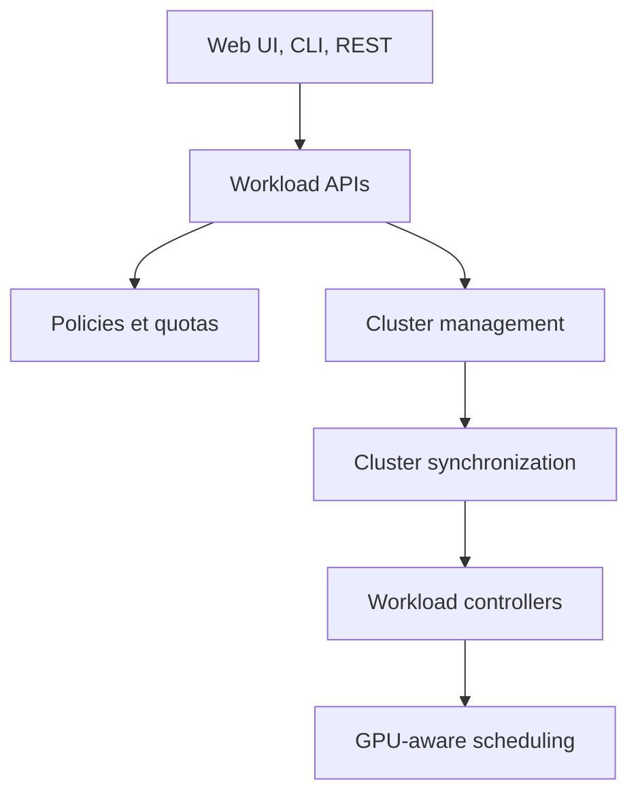

# dsx-ai-factory/run-ai

> Open-source platform for orchestrating AI workloads and GPUs on Kubernetes, for teams sharing a GPU fleet.

## The problem
Several teams compete for the same GPUs, with few quotas, little fine-grained sharing, and no centralized view.

## What it actually does
- GPU-aware scheduling: fair sharing, preemption, grouping, priorities and topology.
- Fractional GPU allocation, quotas per department and project, role-based access control.
- Workload management: workspaces, distributed training and inference.
- Central control plane connected to one or more clusters; web interface, CLI, REST API and MCP server.

## How it is wired


## Trying it
```bash
./local-dev.sh
./local-dev.sh --skip-build --skip-cluster
./local-dev.sh --teardown
```

## Cost and gotchas
Kubernetes or OpenShift required, with GPUs for real value; production installation goes through the `runai-installer` CLI or Helm charts. Images are published on NGC.

## What it is not
Not a replacement for Kubernetes: a layer on top of it. Of no interest for a single team on dedicated GPUs, according to the README.

## Alternatives
- Volcano and Kueue: other schedulers cited in the README, versus the KAI Scheduler shipped here.
- Slurm: alternative for HPC batch jobs on bare metal.

## For you
Worth watching: relevant in MLOps as soon as several teams share a Kubernetes GPU fleet; superfluous on a single machine.
