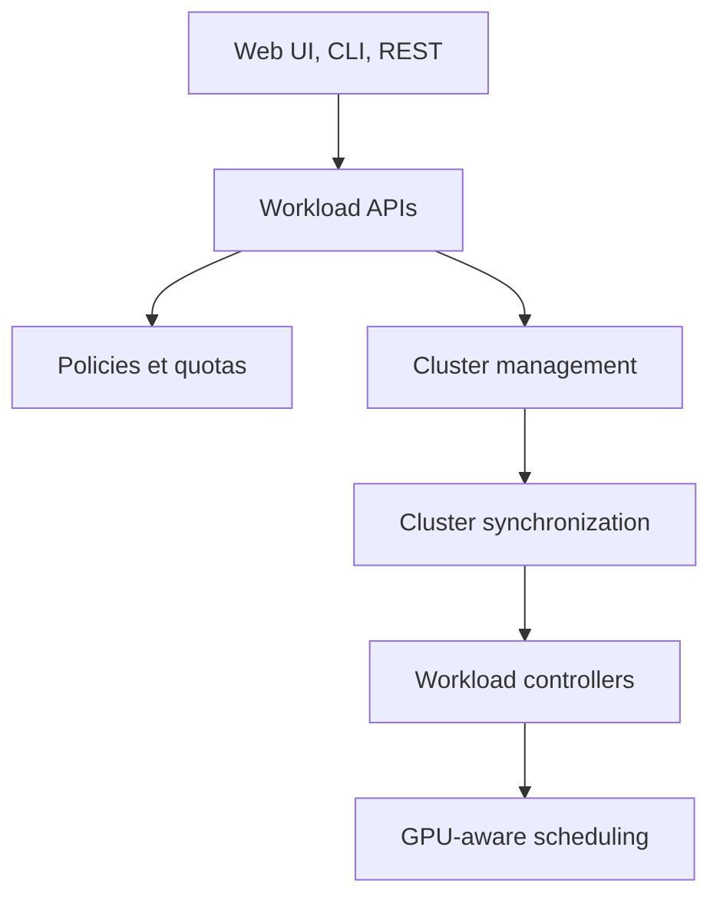

# dsx-ai-factory/run-ai

> Plateforme libre d'orchestration de charges IA et de GPU sur Kubernetes, pour équipes partageant un parc GPU.

## Le problème
Plusieurs équipes se disputent les mêmes GPU, avec peu de quotas, de partage fin ou de vue centralisée.

## Ce que ça fait vraiment
- Ordonnancement conscient des GPU : partage équitable, préemption, groupement, priorités et topologie.
- Allocation fractionnaire de GPU, quotas par départements et projets, contrôle d'accès par rôles.
- Gestion de charges de travail : espaces de travail, entraînement distribué et inférence.
- Plan de contrôle central relié à un ou plusieurs clusters ; interface web, CLI, API REST et serveur MCP.

## Comment c'est branché


## Essayer
```bash
./local-dev.sh
./local-dev.sh --skip-build --skip-cluster
./local-dev.sh --teardown
```

## Coût et pièges
Kubernetes ou OpenShift requis, avec GPU pour l'intérêt réel ; l'installation en production passe par le CLI `runai-installer` ou des charts Helm. Images publiées sur NGC.

## Ce que ce n'est pas
Pas un remplaçant de Kubernetes : une couche au-dessus. Sans intérêt pour une seule équipe sur GPU dédiés, selon le README.

## Alternatives
- Volcano et Kueue : autres ordonnanceurs cités dans le README, face au KAI Scheduler livré ici.
- Slurm : alternative pour du batch HPC sur machine nue.

## Pour toi
À surveiller : pertinent en MLOps dès que plusieurs équipes partagent un parc GPU Kubernetes ; superflu sur une seule machine.

