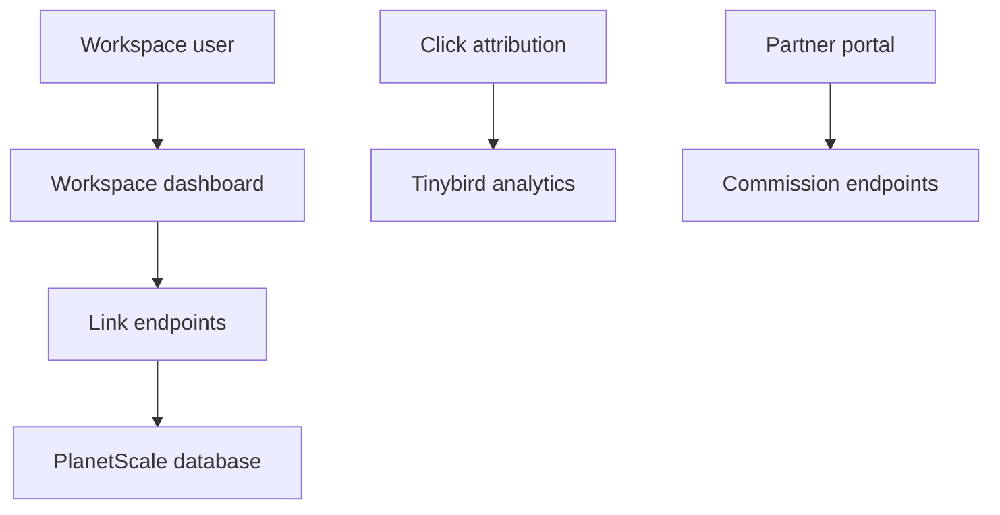

# dubinc/dub

> Open source link attribution platform: short links, conversion tracking and affiliate programs.

## The problem
Tracking clicks and conversions of short links and managing affiliate partners without a proprietary tool.

## What it actually does
Link management in a dashboard, click attribution, analytics, affiliate programs (partners, commissions, payouts), embeddable referral module, admin console. Self-hostable according to the README, with a stack of third-party services.

## How it is wired


## Trying it
```bash
pnpm prisma:push
cd apps/web
pnpm run script dev/seed
```

## Cost and gotchas
Imposed stack: PlanetScale, Upstash, Tinybird, Stripe, Resend, Vercel. Node v23.11.0 and pnpm 9.15.9 recommended. License present but not identified: to be checked.

## What it is not
Not a data/ML tool. Self-hosting is non-trivial: many third-party accounts.

## Alternatives
None named in the README.

## For you
Ignore: marketing tool unrelated to data/AI/MLOps, and an expensive stack to set up.
