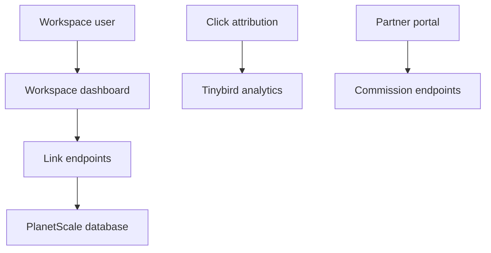

# dubinc/dub

> Plateforme open source d'attribution de liens : liens courts, suivi de conversions et programmes d'affiliation.

## Le problème
Suivre les clics et conversions de liens courts et gérer des partenaires d'affiliation sans outil propriétaire.

## Ce que ça fait vraiment
Gestion de liens dans un tableau de bord, attribution des clics, analytics, programmes d'affiliation (partenaires, commissions, paiements), module de parrainage intégrable, console admin. Auto-hébergeable selon le README, avec une pile de services tiers.

## Comment c'est branché


## Essayer
```bash
pnpm prisma:push
cd apps/web
pnpm run script dev/seed
```

## Coût et pièges
Pile imposée : PlanetScale, Upstash, Tinybird, Stripe, Resend, Vercel. Node v23.11.0 et pnpm 9.15.9 recommandés. Licence présente mais non identifiée : à vérifier.

## Ce que ce n'est pas
Pas un outil data/ML. Auto-hébergement non trivial : de nombreux comptes tiers.

## Alternatives
Aucune nommée dans le README.

## Pour toi
À ignorer : outil de marketing sans rapport avec data/IA/MLOps, et pile coûteuse à monter.

