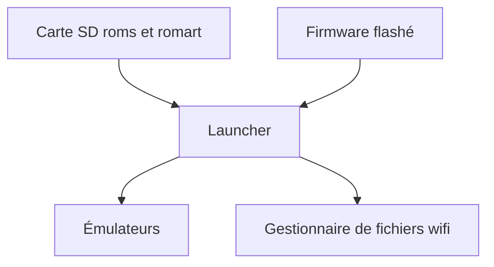

# ducalex/retro-go

> Retro gaming firmware for ESP32 devices such as the ODROID-GO, with optimized emulators.

## The problem
Small ESP32 devices have little memory and CPU to emulate consoles.

## What it actually does
A launcher and half a dozen emulation apps (Game Boy, NES, MSX, Game & Watch). In-game menu, favorites, save states, cover art, palettes, a wifi file manager, external DAC.

## How it is wired
Simplified diagram based on the sheet, no diagram provided.


## Trying it
```bash
esptool.py write_flash --flash_size detect 0x0 retro-go_*.img
```
For the ODROID-GO: copy the `.fw` to the SD card, then flash by holding B at boot.

## Cost and gotchas
Free, but you need a compatible device and an SD card. You must supply the ROMs and BIOS yourself. NTP synchronization cannot be disabled.

## What it is not
Not an emulator for PC. ROMs are not provided. Compatibility depends on your device.

## Alternatives
No alternative named in the README.

## For you
Ignore: hobby firmware on dedicated hardware, unrelated to data, AI or MLOps.
