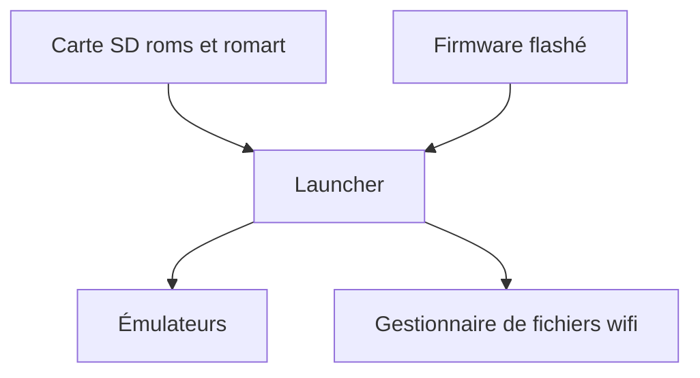

# ducalex/retro-go

> Firmware de jeux rétro pour appareils ESP32 comme l'ODROID-GO, avec émulateurs optimisés.

## Le problème
Les petits appareils ESP32 ont peu de mémoire et de CPU pour émuler des consoles.

## Ce que ça fait vraiment
Un lanceur et une demi-douzaine d'applications d'émulation (Game Boy, NES, MSX, Game & Watch). Menu en jeu, favoris, états de sauvegarde, jaquettes, palettes, gestionnaire de fichiers par wifi, DAC externe.

## Comment c'est branché
Schéma simplifié d'après la fiche, sans diagramme fourni.


## Essayer
```bash
esptool.py write_flash --flash_size detect 0x0 retro-go_*.img
```
Pour l'ODROID-GO : copier le `.fw` sur la carte SD puis flasher en maintenant B au démarrage.

## Coût et pièges
Gratuit, mais il faut un appareil compatible et une carte SD. Les roms et BIOS sont à fournir toi-même. La synchronisation NTP ne peut pas être désactivée.

## Ce que ce n'est pas
Pas un émulateur pour PC. Les roms ne sont pas fournies. La compatibilité dépend de ton appareil.

## Alternatives
Aucune alternative nommée dans le README.

## Pour toi
À ignorer : firmware de loisir sur matériel dédié, sans lien avec la data, l'IA ou le MLOps.

