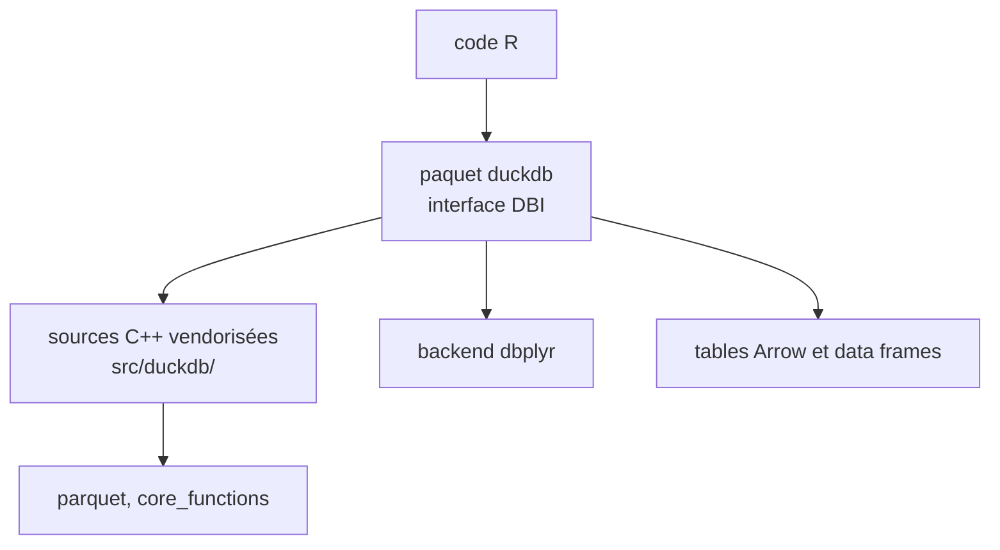

# duckdb/duckdb-r

> R interface for DuckDB, an embedded analytical SQL database, installable as an R package.

## The problem
Analyzing large CSV or Parquet files or data frames in SQL from R, without installing a database server.

## What it actually does
Implements the DBI interface for DuckDB, with the C++ sources vendored in `src/duckdb/` and compiled. dbplyr backend; data frames and Arrow objects can be registered as tables; CSV files are read by the engine. Only `parquet` and `core_functions` are linked; everything else is installed on demand. Several package variants follow the upstream series.

## How it is wired
Simplified diagram based on the fiche, no diagram provided.


## Trying it
```bash
# dans R
# install.packages("duckdb")
# install.packages("duckdb", repos = c("https://duckdb.r-universe.dev", "https://cloud.r-project.org"))
# pak::pak("duckdb/duckdb-r")
```

## Cost and gotchas
Free. Installing from source can take up to an hour on Linux; prefer the CRAN binaries, Posit Package Manager or r-universe. License not recognized by GitHub: to be checked.

## What it is not
Not the command-line client, nor a library usable outside R. The relational API is internal: duckplyr is the only intended consumer.

## Alternatives
Not documented in the README (duckplyr is mentioned as a consumer).

## For you
Adopt it if you analyze data in R: DuckDB installs there as a simple package, with no server.
