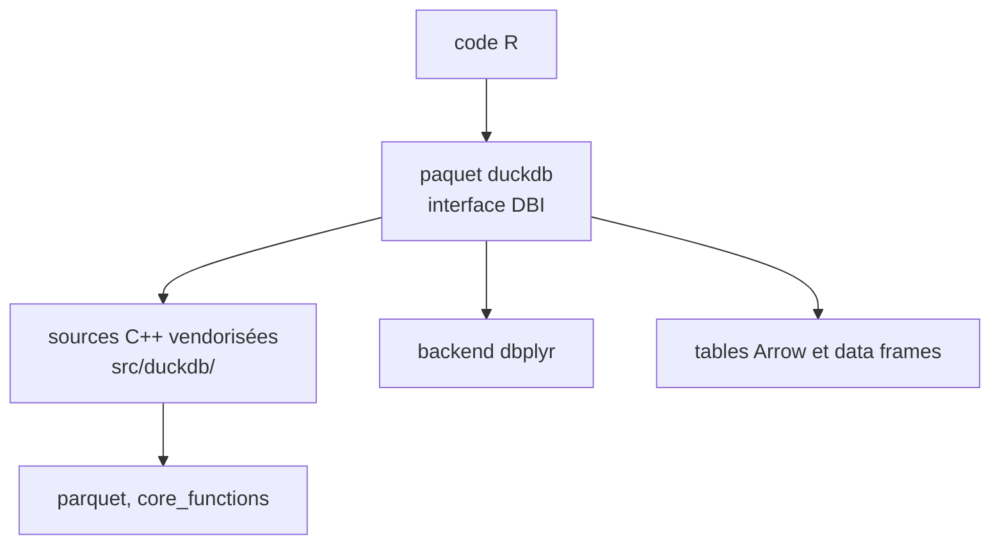

# duckdb/duckdb-r

> Interface R de DuckDB, base SQL analytique embarquée, installable comme paquet R.

## Le problème
Analyser de gros fichiers CSV, Parquet ou des data frames en SQL depuis R sans serveur de base à installer.

## Ce que ça fait vraiment
Implémente l'interface DBI pour DuckDB, avec les sources C++ vendorisées dans `src/duckdb/` et compilées. Backend dbplyr, data frames et objets Arrow enregistrables comme tables, CSV lus par le moteur. Seuls `parquet` et `core_functions` sont liés ; le reste s'installe à la demande. Plusieurs variantes de paquet suivent les séries amont.

## Comment c'est branché
Schéma simplifié d'après la fiche, sans diagramme fourni.


## Essayer
```bash
# dans R
# install.packages("duckdb")
# install.packages("duckdb", repos = c("https://duckdb.r-universe.dev", "https://cloud.r-project.org"))
# pak::pak("duckdb/duckdb-r")
```

## Coût et pièges
Gratuit. L'installation depuis les sources peut prendre jusqu'à une heure sous Linux ; préférer les binaires CRAN, Posit Package Manager ou r-universe. Licence non reconnue par GitHub : à vérifier.

## Ce que ce n'est pas
Pas le client en ligne de commande ni une bibliothèque utilisable hors de R. L'API relationnelle est interne : duckplyr est le seul consommateur prévu.

## Alternatives
Non documenté dans le README (duckplyr cité comme consommateur).

## Pour toi
À adopter si tu analyses des données sous R : DuckDB s'y installe comme un simple paquet, sans serveur.

