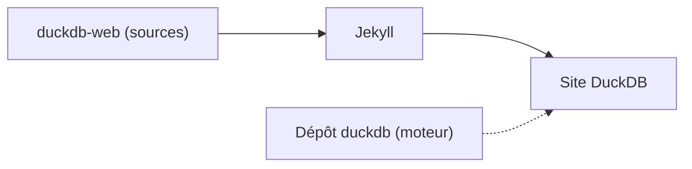

# duckdb/duckdb-web

> Sources of the DuckDB website and documentation, for documentation contributors.

## The problem
The documentation of a database engine must live in a repository open to corrections and questions.

## What it actually does
Contains the DuckDB website and documentation, built with Jekyll. The engine itself is in another repository. The README is only a few lines long: the rest is not documented here.

## How it is wired
Simplified diagram based on the sheet, no diagram provided.

## Trying it
No command documented in the README: it points to a guide for building the site (Jekyll locally or via Docker).

## Cost and gotchas
No cost. Jekyll (Ruby) or Docker is needed to build the site, which the README does not specify.

## What it is not
It is not DuckDB: the engine is in the duckdb repository. It cannot be installed and provides no tool.

## Alternatives
No alternative named in the README.

## For you
Ignore as a repository to follow: you use DuckDB through its package, not these sources, except to fix the documentation.
