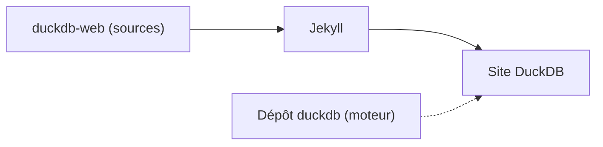

# duckdb/duckdb-web

> Sources du site web et de la documentation de DuckDB, pour contributeurs à la doc.

## Le problème
La documentation d'un moteur de base de données doit vivre dans un dépôt ouvert à corrections et questions.

## Ce que ça fait vraiment
Contient le site et la documentation de DuckDB, construits avec Jekyll. Le moteur lui-même est dans un autre dépôt. Le README tient en quelques lignes : le reste n'est pas documenté ici.

## Comment c'est branché
Schéma simplifié d'après la fiche, sans diagramme fourni.

## Essayer
Aucune commande documentée dans le README : il renvoie à un guide de construction du site (Jekyll en local ou via Docker).

## Coût et pièges
Aucun coût. Jekyll (Ruby) ou Docker nécessaire pour construire le site, non précisé dans le README.

## Ce que ce n'est pas
Ce n'est pas DuckDB : le moteur est dans le dépôt duckdb. Il ne s'installe pas et n'apporte pas d'outil.

## Alternatives
Aucune alternative nommée dans le README.

## Pour toi
À ignorer comme dépôt à suivre : tu utilises DuckDB via son paquet, pas ces sources, sauf pour corriger la documentation.

