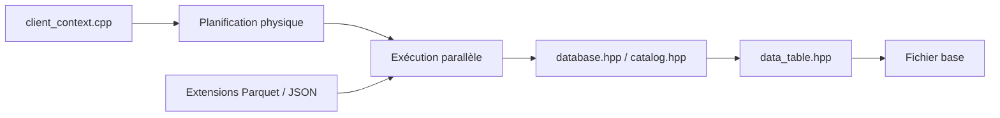

# duckdb/duckdb

> Embedded analytical SQL database, serverless, that reads CSV and Parquet directly.

## The problem
Querying large files or joining several sources usually requires a database server or an ingestion pipeline.

## What it actually does
Runs inside the application process. Rich SQL (correlated subqueries, window functions, nested types). Reads and writes CSV, Parquet, JSON, Excel, locally or on S3, HTTP, Azure, GCS. Connects to PostgreSQL, MySQL, SQLite; supports DuckLake, Iceberg, Delta Lake. Loadable extensions. Clients for Python, R, Java, Rust, Go, Wasm.

## How it is wired


## Trying it
```sql
SELECT * FROM 'myfile.csv';
SELECT * FROM 'myfile.parquet';
```
Build: `make`, then `make unit` to test. Common installation is described on the installation page of the website.

## Cost and gotchas
Free. Building requires CMake, Python 3 and a C++17 compiler. The "quack" protocol exposes an instance as an HTTP server: to be secured.

## What it is not
Not a distributed multi-user warehouse. Not a replacement for a transactional database.

## Alternatives
No alternative named in the README.

## For you
Adopt: querying Parquet and CSV locally without infrastructure is a direct gain for data exploration.
