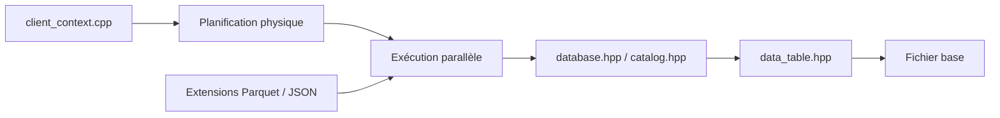

# duckdb/duckdb

> Base analytique embarquée en SQL, sans serveur, qui lit CSV et Parquet directement.

## Le problème
Interroger des fichiers volumineux ou joindre plusieurs sources demande habituellement un serveur de base ou un pipeline d'ingestion.

## Ce que ça fait vraiment
S'exécute dans le processus de l'application. SQL riche (sous-requêtes corrélées, fenêtres, types imbriqués). Lit et écrit CSV, Parquet, JSON, Excel, en local ou sur S3, HTTP, Azure, GCS. Se branche sur PostgreSQL, MySQL, SQLite ; supporte DuckLake, Iceberg, Delta Lake. Extensions chargeables. Clients Python, R, Java, Rust, Go, Wasm.

## Comment c'est branché


## Essayer
```sql
SELECT * FROM 'myfile.csv';
SELECT * FROM 'myfile.parquet';
```
Compilation : `make`, puis `make unit` pour tester. L'installation courante est décrite sur la page d'installation du site.

## Coût et pièges
Gratuit. La compilation demande CMake, Python 3 et un compilateur C++17. Le protocole « quack » expose une instance en serveur HTTP : à sécuriser.

## Ce que ce n'est pas
Pas un entrepôt multi-utilisateurs distribué. Pas un remplaçant de base transactionnelle.

## Alternatives
Aucune alternative nommée dans le README.

## Pour toi
Adopter : requêter des Parquet et du CSV en local sans infrastructure est un gain direct pour l'exploration de données.

