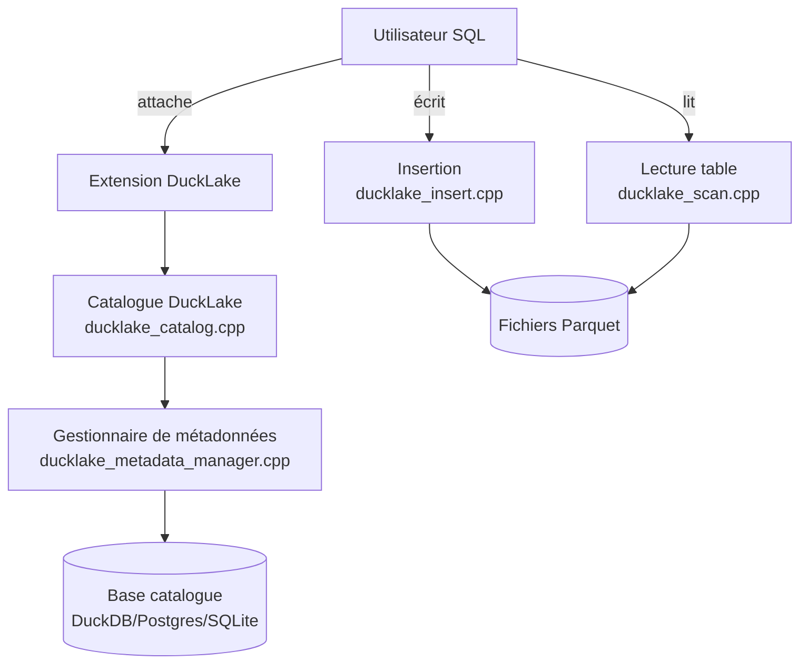

# duckdb/ducklake

> A DuckDB extension that reads and writes a SQL lakehouse format storing its data in Parquet.

## The problem
A classic lakehouse mixes table format and query engine, which complicates versioning and schema evolution. DuckLake wants an ordinary SQL table, with history and evolving schema.

## What it actually does
Stores metadata in a catalog database (DuckDB, PostgreSQL, SQLite or Quack) and data in Parquet files. Allows `ATTACH`, table creation/modification in standard SQL, time travel by version, schema evolution without migration and a change feed (`table_changes`) of the CDC type.

## How it is wired


## Trying it
```sql
INSTALL ducklake;
ATTACH 'ducklake:metadata.ducklake' AS my_ducklake (DATA_PATH 'file_path/');
USE my_ducklake;
CREATE TABLE my_ducklake.my_table(id INTEGER, val VARCHAR);
INSERT INTO my_ducklake.my_table VALUES (1, 'Hello'), (2, 'World');
FROM my_ducklake.my_table;
```

## Cost and gotchas
Free and keyless, but it is an extension: you must already have DuckDB. Building the extension yourself requires the Git submodules and a C++ build toolchain.

## What it is not
Not a managed service nor a standalone query engine: DuckLake depends entirely on DuckDB as its execution engine. Does not replace a full Hive/Iceberg catalog if the target ecosystem already requires it.

## Alternatives
No alternative named in the README.

## For you
Adopt for a data scientist who wants a lightweight versioned lakehouse without heavy infrastructure, directly from DuckDB.
