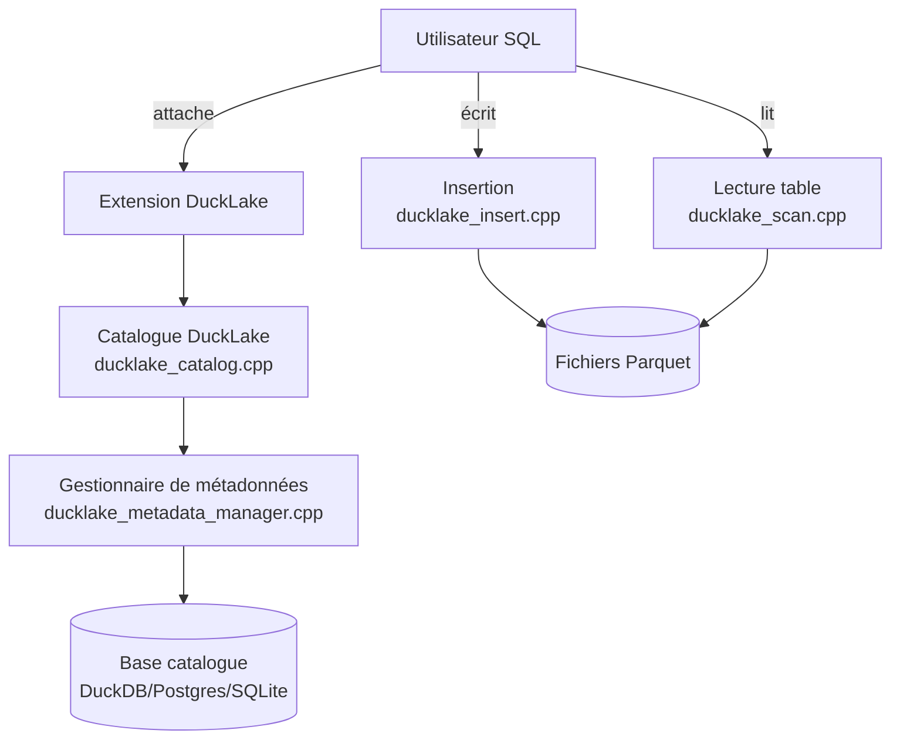

# duckdb/ducklake

> Une extension DuckDB qui lit et écrit un format de lakehouse SQL stockant ses données en Parquet.

## Le problème
Un lakehouse classique mélange format de table et moteur de requête, ce qui complique le versionnage et l'évolution de schéma. DuckLake veut une table SQL ordinaire, avec historique et schéma évolutif.

## Ce que ça fait vraiment
Stocke les métadonnées dans une base catalogue (DuckDB, PostgreSQL, SQLite ou Quack) et les données en fichiers Parquet. Permet `ATTACH`, création/modification de tables en SQL standard, voyage dans le temps par version, évolution de schéma sans migration et un flux de changements (`table_changes`) type CDC.

## Comment c'est branché


## Essayer
```sql
INSTALL ducklake;
ATTACH 'ducklake:metadata.ducklake' AS my_ducklake (DATA_PATH 'file_path/');
USE my_ducklake;
CREATE TABLE my_ducklake.my_table(id INTEGER, val VARCHAR);
INSERT INTO my_ducklake.my_table VALUES (1, 'Hello'), (2, 'World');
FROM my_ducklake.my_table;
```

## Coût et pièges
Gratuit et sans clé, mais c'est une extension : il faut déjà avoir DuckDB. Compiler soi-même l'extension demande les sous-modules Git et une chaîne de build C++.

## Ce que ce n'est pas
Pas un service managé ni un moteur de requête autonome : DuckLake dépend entièrement de DuckDB comme moteur d'exécution. Ne remplace pas un catalogue Hive/Iceberg complet si l'écosystème cible l'exige déjà.

## Alternatives
Aucune alternative nommée dans le README.

## Pour toi
À adopter pour un data scientist qui veut un lakehouse léger versionné sans infrastructure lourde, directement depuis DuckDB.

