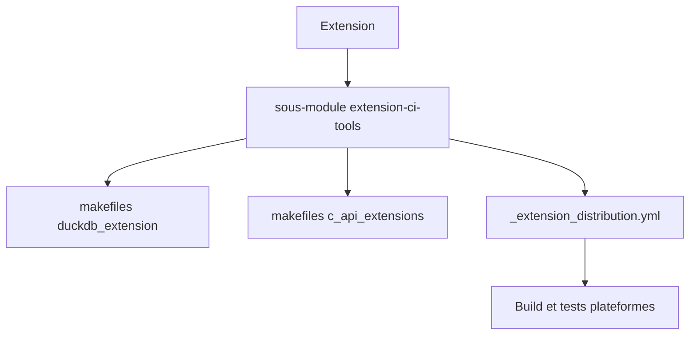

# duckdb/extension-ci-tools

> Shared Makefiles and GitHub Actions workflows to build, test and deploy DuckDB extensions.

## The problem
Otherwise each DuckDB extension would have to copy its own cross-platform build configuration and CI.

## What it actually does
Added as a git submodule. Provides makefiles (standard extension, vcpkg, C API) and a reusable workflow `_extension_distribution.yml`. Supports C++, Rust (`enable_rust`) and the C API, and uses a static DuckDB archive from staging if available, otherwise builds DuckDB. Common targets: `make debug`, `make test_debug`, `make release`.

## How it is wired


## Trying it
```bash
git submodule update --init --recursive
make debug
make test_debug
make release
```

## Cost and gotchas
Free. License missing from the catalog: to be checked. The workflow is referenced as `@main` in the examples, so it is not pinned.

## What it is not
Not a tool for using DuckDB: only for those who write and publish extensions.

## Alternatives
None named in the README.

## For you
Worth watching: useful only if you write a DuckDB extension, otherwise of no interest.
