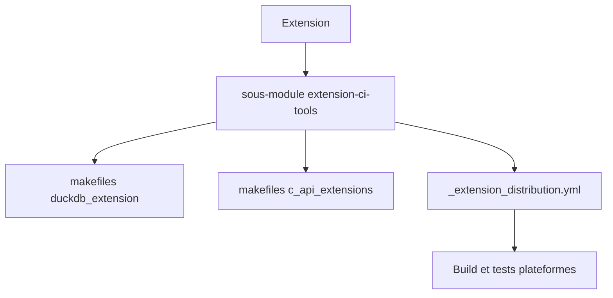

# duckdb/extension-ci-tools

> Makefiles et workflows GitHub Actions partagés pour construire, tester et déployer des extensions DuckDB.

## Le problème
Chaque extension DuckDB devrait sinon recopier sa configuration de build multiplateforme et sa CI.

## Ce que ça fait vraiment
S'ajoute en sous-module git. Fournit des makefiles (extension standard, vcpkg, API C) et un workflow réutilisable `_extension_distribution.yml`. Gère C++, Rust (`enable_rust`) et l'API C, et utilise une archive statique de DuckDB en staging si disponible, sinon compile DuckDB. Cibles communes : `make debug`, `make test_debug`, `make release`.

## Comment c'est branché


## Essayer
```bash
git submodule update --init --recursive
make debug
make test_debug
make release
```

## Coût et pièges
Gratuit. Licence absente du catalogue : à vérifier. Le workflow est référencé en `@main` dans les exemples, donc non épinglé.

## Ce que ce n'est pas
Pas un outil pour utiliser DuckDB : seulement pour qui écrit et publie des extensions.

## Alternatives
Aucune nommée dans le README.

## Pour toi
Surveiller : utile seulement si tu écris une extension DuckDB, sinon sans intérêt.

